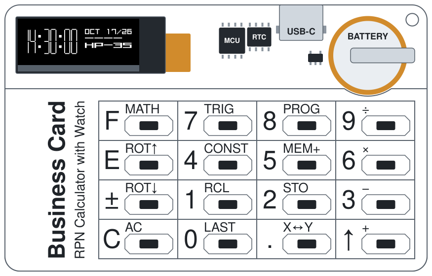

# Business Card RPN Calculator with Watch

A scientific RPN calculator with a watch, on one PCB of the size of a credit card (85.5 × 54 mm).

The calculator is an emulator of a real HP calculator of the 1970s. The firmware runs the original HP ROM on a virtual copy of the HP CPU. Thus, the calculations, the results and the display format are the same as on the original calculator. The firmware also adds functions that the original calculator did not have, for example the watch.

## Hardware

The hardware platform of the device has the name Tiny RPN Calculator (PCB rev 1.5). All the parts are on one PCB:

- [ATtiny85](datasheets/ATtiny85.pdf) microcontroller. It has only 8 KB of flash memory, but the firmware, the emulator and the original HP ROM fit in it.
- 0.91-inch OLED display, 128 × 32 pixels, with the [SSD1306](datasheets/SSD1306.pdf) controller.
- [DS3231M](datasheets/DS3231M.pdf) real-time clock. It keeps the time and the date when the device is off.
- 16 keys on one analog input of the microcontroller.
- [LIR1620](datasheets/LIR1620.pdf) (default) or [LIR1632](datasheets/LIR1632.pdf) rechargeable lithium-ion coin battery, with an [XB5358D0](datasheets/XB5358D0.pdf) protection IC.
- [MCP73832](datasheets/MCP73831.pdf) charger. It charges the battery through the USB-C connector.

The device has no ON/OFF switch. The firmware turns the device off when you do not use it. A key in the two bottom rows turns it on again.

For the full circuit, refer to the [schematic](hardware/pcb-rev1.5/Tiny-RPN-Calculator-rev1.5_Schematic.pdf). The [TinyRPNCalculator](firmware/libraries/TinyRPNCalculator) Arduino library supports this hardware. All the firmware uses it.

## Firmware

Each firmware emulates one HP calculator. The source code of each firmware is an Arduino sketch. Each firmware has its own user manual. For the available manuals, refer to [Documentation](#documentation).

| Firmware | Calculator | Added functions | Status |
| --- | --- | --- | --- |
| [HP-35 Firmware](firmware/sketches/hp35) | HP-35 (1972), the first pocket calculator with scientific functions | Watch, TOTP codes for two-factor authentication | Ready |
| [HP-21 Firmware](firmware/sketches/hp21) | HP-21 (1975) | Watch | Not tested on the device |

To install the firmware, refer to [Firmware installation](documents/manuals/hp35-firmware-user-manual.md#14-firmware-installation) in the HP-35 Firmware — User Manual.

## Documentation

| Document | Content |
| --- | --- |
| [HP-35 Firmware — User Manual](documents/manuals/hp35-firmware-user-manual.md) | How to use the device with the HP-35 firmware: calculator, watch, TOTP codes, firmware installation |
| [HP-35 Operating Manual](documents/manuals/hp35-om-en-remake.pdf) | Remake of the original Hewlett-Packard manual: all functions of the HP-35, with examples (PDF, 23 MB) |
| [HP-21 Owner's Handbook](documents/manuals/hp21-oh-en.pdf) | Original Hewlett-Packard manual of the HP-21 (PDF, 16 MB) |

## License

[MIT](LICENSE)
