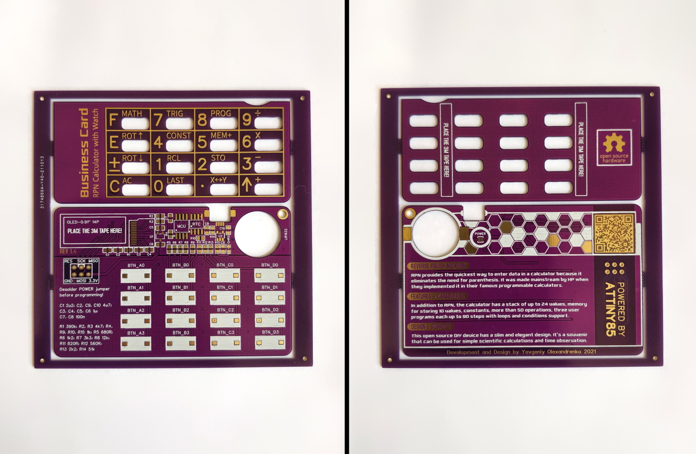
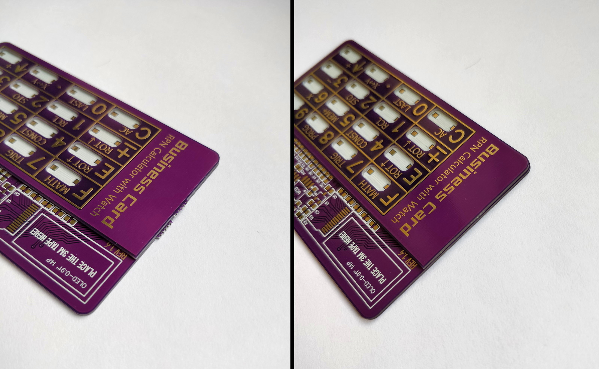
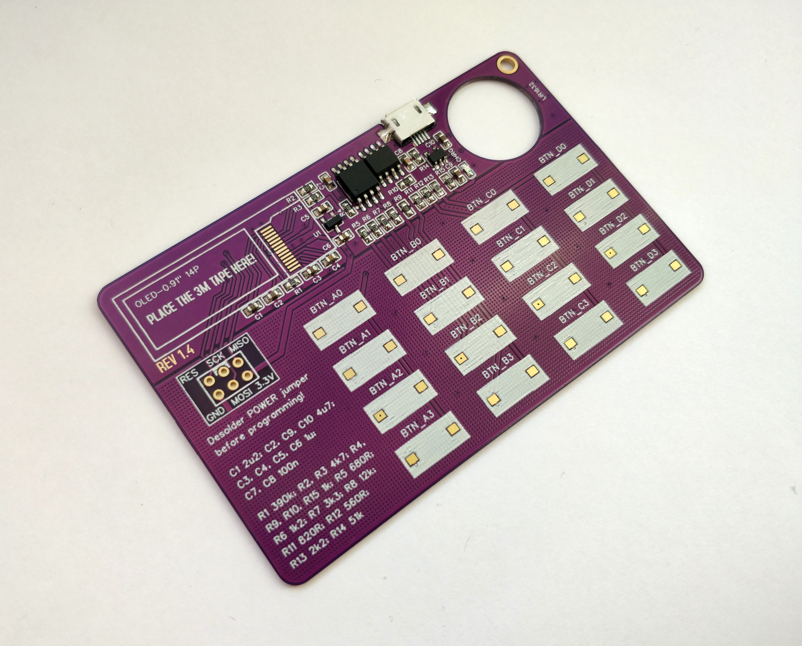
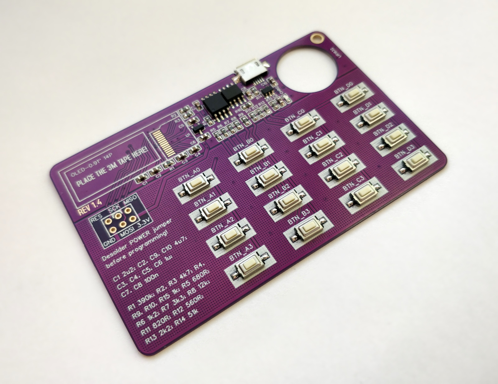
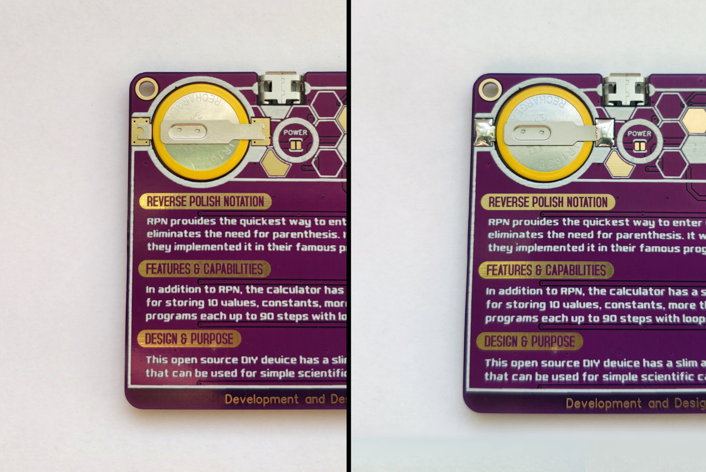
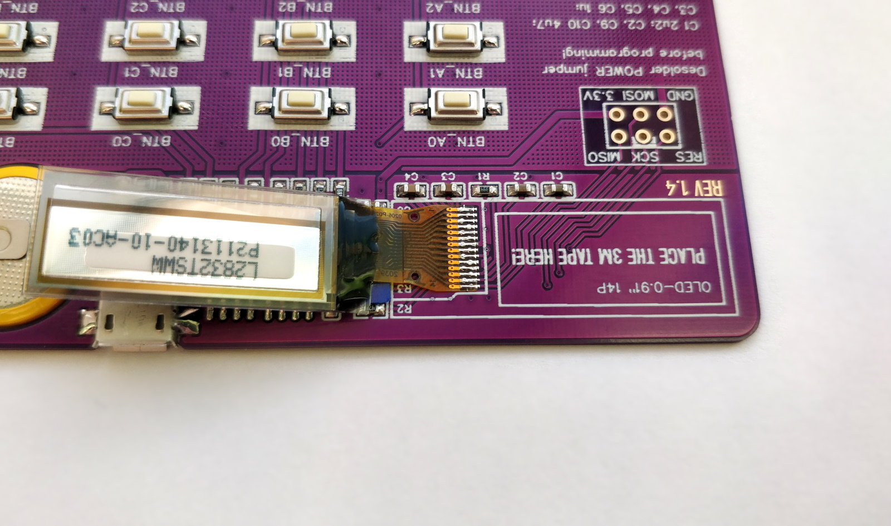
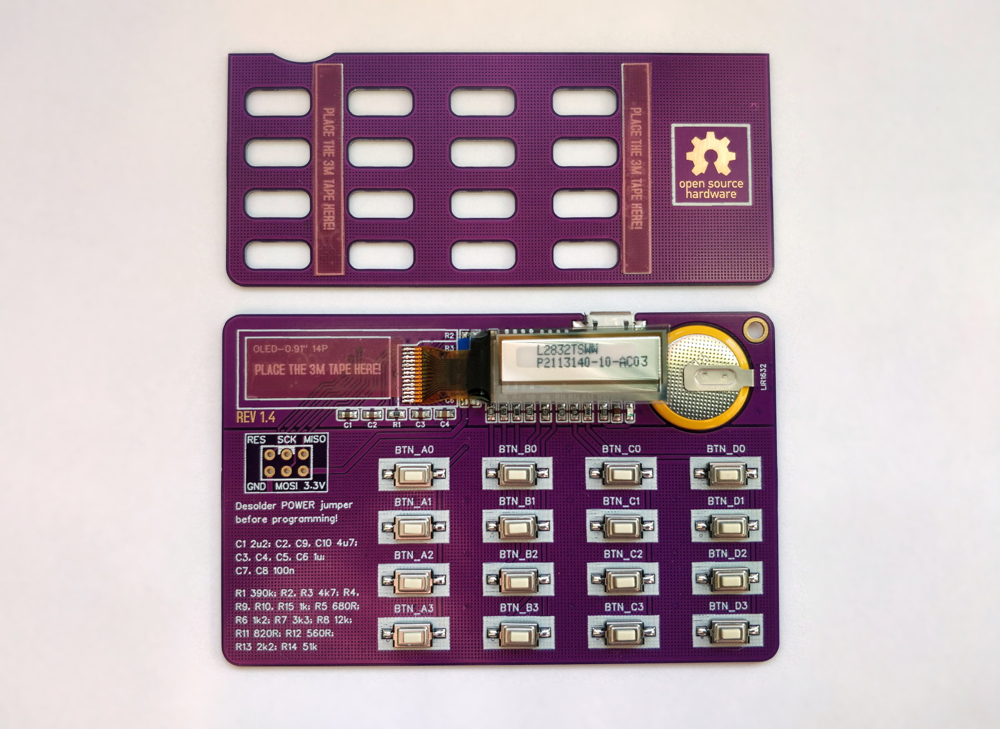
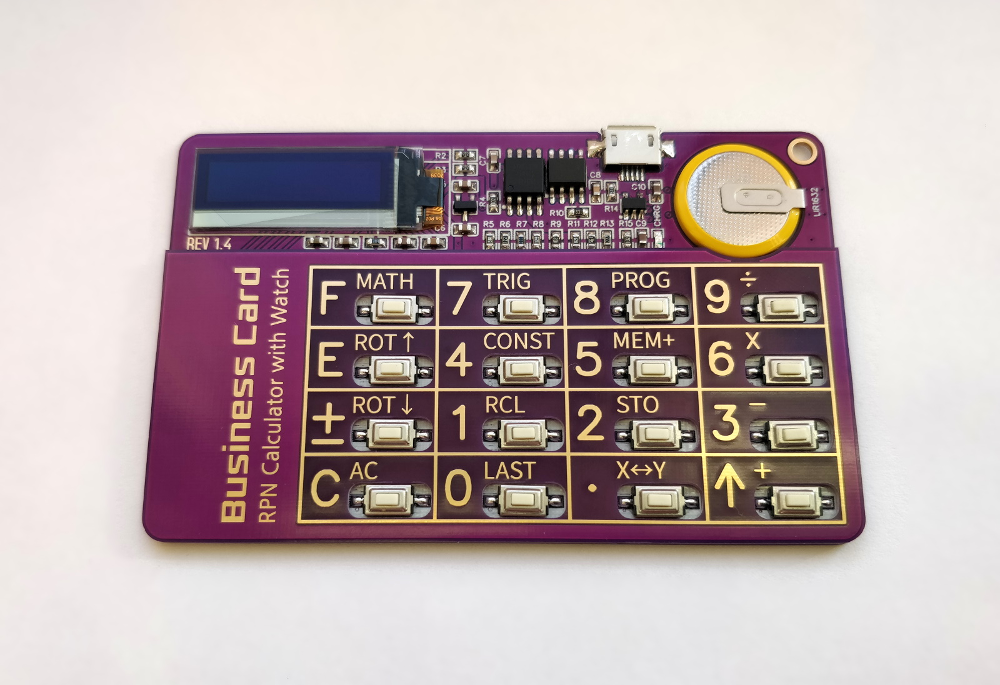

# How to Build the Business Card RPN Calculator with Watch

## Step 1 - TODO

## Step 2 - TODO

## Step 3 - SMD Components

## Step 4 - Buttons

## Step 5 - Battery

## Step 6 - Display

## Step 7 - Ultra-thin 3M tape

## Step 8 - Programming

Write the firmware to the device. Refer to [HP-35 Firmware — User Manual](../manuals/hp35-firmware-user-manual.md#14-firmware-installation), section 14.

## Step 9 - Finished Device

