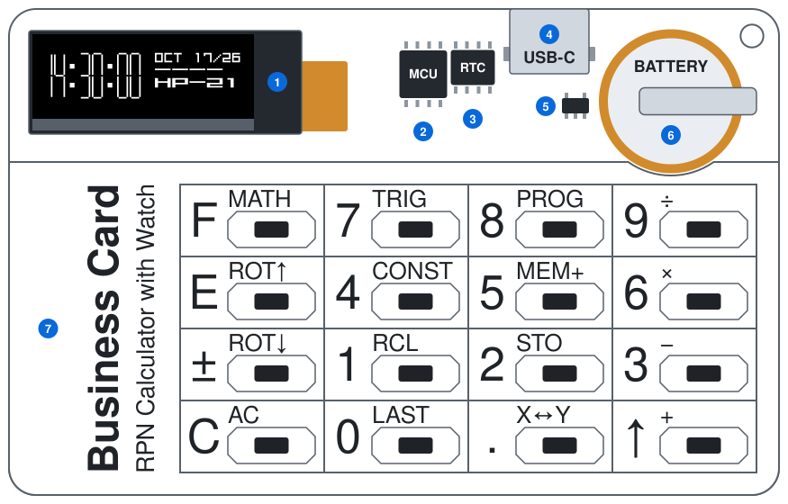
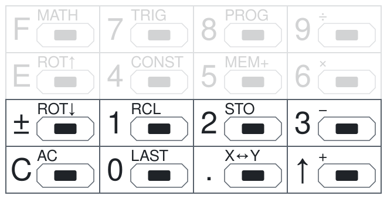
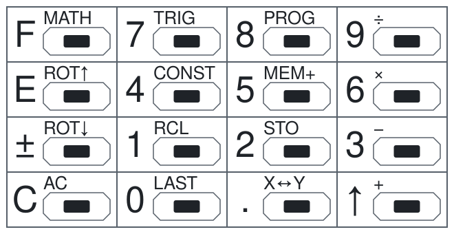
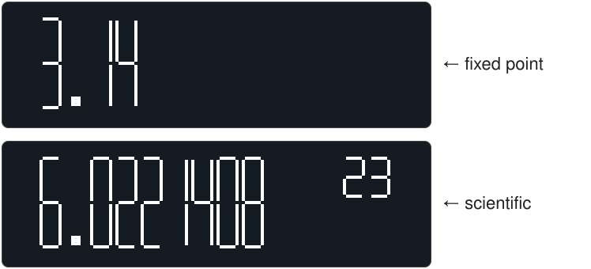
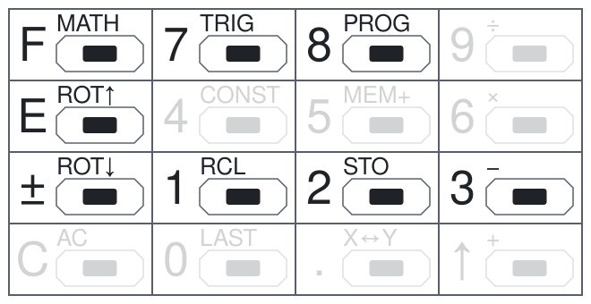
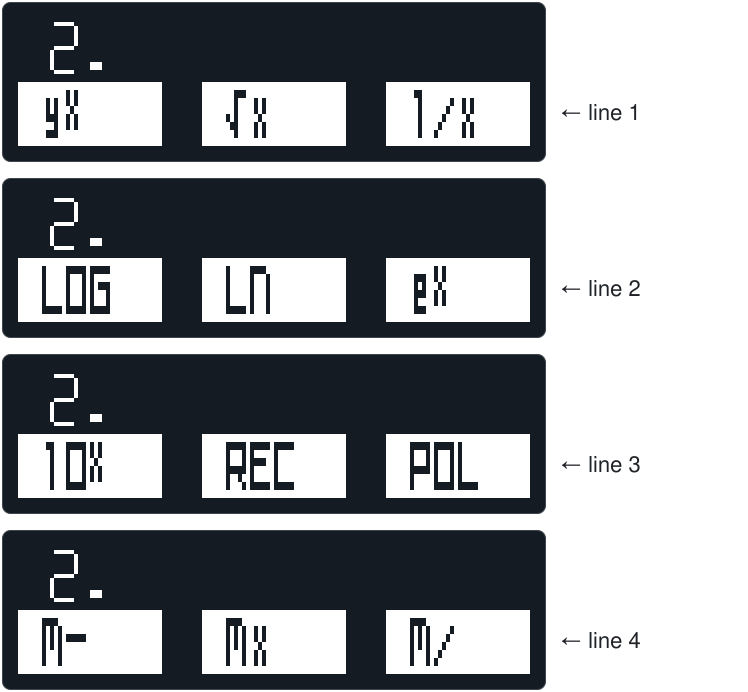
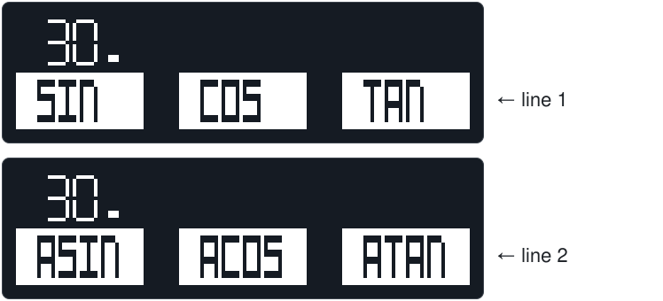
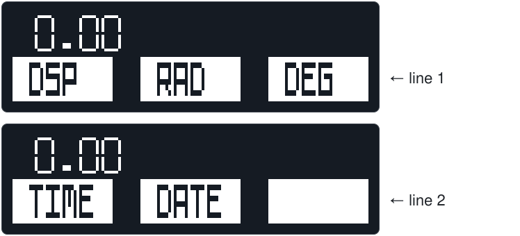

# HP-21 Firmware — User Manual

<details>
<summary><b>Contents</b></summary>

1. [Introduction](#1-introduction)
2. [Safety](#2-safety)
3. [Device description](#3-device-description)
4. [Power and battery](#4-power-and-battery)
5. [Operating modes](#5-operating-modes)
6. [Keyboard](#6-keyboard)
7. [Watch mode](#7-watch-mode)
8. [Calculator mode](#8-calculator-mode)
9. [Menus](#9-menus)
10. [Set the time and the date](#10-set-the-time-and-the-date)
11. [Examples](#11-examples)
12. [Troubleshooting](#12-troubleshooting)
13. [Firmware installation](#13-firmware-installation)
14. [Technical data](#14-technical-data)
15. [Quick reference](#15-quick-reference)

</details>

## 1. Introduction

This manual tells you how to use the HP-21 firmware on the Business Card RPN Calculator with Watch. The device uses the Tiny RPN Calculator hardware platform, PCB rev 1.5. Each firmware of the device has its own manual.

With the HP-21 firmware, the device has two functions:

- An HP-21 calculator (refer to [8](#8-calculator-mode)).
- A watch (refer to [7](#7-watch-mode)).

### 1.1 The HP-21 calculator

Hewlett-Packard introduced the HP-21 in 1975. It was the first calculator of the HP Woodstock series, and it replaced the HP-35. The HP-21 was smaller and less expensive than the HP-35. Its ROM has 1024 instructions, a third more than the ROM of the HP-35 (768 instructions). In this space, HP added functions that the HP-35 did not have: angles in radians, a selectable display format, coordinate conversion, the common antilogarithm (10ˣ) and arithmetic in the memory.

The firmware is an emulator. It runs the original ROM of the HP-21 on a virtual copy of the HP CPU, at about the speed of the original calculator. Thus, the calculations, the results and the display format are the same as on the HP-21. The firmware also adds some functions that make the calculator easier to use. This manual marks them with this label: 

For more data, refer to:

- [HP-21 Owner's Handbook](hp21-oh-en.pdf): all functions of the HP-21, with examples.
- [HP-21 page of the Museum of HP Calculators](https://www.hpmuseum.org/hp21.htm): photos and history.

### 1.2 Differences from the HP-21

The device has a different keyboard, display and power supply. The table shows the differences:

| HP-21 | This firmware |
| --- | --- |
| 30 keys. The blue shift key selects the functions on the front faces of the keys. | 16 keys. The <kbd>F</kbd> key selects the shifted functions and opens the menus (refer to [6](#6-keyboard) and [9](#9-menus)). |
| DEG/RAD switch. | The items RAD and DEG of the PROG menu, and the R indicator (refer to [8.8](#88-angles)). |
| OFF/ON switch. When you turn the HP-21 off and on again, it clears the stack and the memory, and sets the display format FIX 2. | The device turns off automatically. It keeps the stack, the memory, the display format and the angle mode (refer to [4.3](#43-automatic-power-off-and-power-on)). |
| Low-power warning: all decimal points light. | The battery indicator on the watch screen (refer to [4.2](#42-battery-indicator)). |
| LED display with 12 positions. | OLED display. In calculator mode, it shows the same 12 positions (refer to [8.2](#82-display)). |

### 1.3 Symbols and conventions

The text uses these symbols:

> [!NOTE]
> Data that helps you to use the device.

> [!TIP]
> A faster or easier procedure.

> [!IMPORTANT]
> Data that you must know to get the correct result.

> [!WARNING]
> A risk of injury.

> [!CAUTION]
> A risk of damage to the device or of incorrect operation.

The text uses these conventions:

| Text | Meaning |
| --- | --- |
| <kbd>F</kbd> <kbd>9</kbd> | Push the <kbd>F</kbd> key and release it. Then push the <kbd>9</kbd> key. |
| <kbd>F</kbd> <kbd>7</kbd> <kbd>1</kbd> (SIN) | The keys to push, then the name of the operation that they do. |
| <kbd>ENTER↑</kbd> | A key of the original HP-21. The "HP-21 keys" columns of the tables show the HP-21 keys for the same operation. |
| <kbd>√x</kbd> | A blue function of the original HP-21 (a legend on the front face of a key). On the HP-21, push the blue shift key first. |
| `0.00` | The text on the display. |

## 2. Safety

> [!WARNING]
> The device has a rechargeable lithium battery.
> - Do not bend the PCB. A bent PCB can damage the battery.
> - Do not puncture, crush or heat the battery.
> - If the battery becomes swollen or hot, disconnect the USB cable immediately. Do not use the device again.
> - Charge the battery only through the USB-C connector of the device.
> - Keep the device away from small children. The coin battery and the small parts can cause serious injury if a person swallows them.

> [!CAUTION]
> The PCB has no case. The electronic parts are not protected.
> - Keep the device away from water and metal objects. Metal objects can cause a short circuit.
> - Do not touch the parts with wet hands.

> [!CAUTION]
> The VCC line of the device connects directly to the battery. There is no voltage regulator.
> - Do not supply 5 V from the ICSP programmer when the battery is connected. Use a programmer that does not supply power, or set it to 3.3 V.
> - Do not connect the ICSP programmer and the USB cable at the same time.

> [!NOTE]
> Do not discard the device and the battery with household waste. Take them to a collection point for electronic waste and batteries.

## 3. Device description

The device has the size and the proportions of a credit card. The drawing shows the primary parts. The positions of the small parts are approximate. The drawing does not show the ICSP connector and the POWER jumper.



| No. | Part | Function |
| :---: | --- | --- |
| 1 | Display | Shows numbers, menus and time (refer to [8.2](#82-display)). |
| 2 | Microcontroller | Runs the firmware. |
| 3 | Real-time clock | Keeps the time and the date. |
| 4 | USB-C connector | Connects the USB cable to charge the battery (refer to [4.1](#41-charge-the-battery)). |
| 5 | Charger | Charges the battery and controls the charge current. |
| 6 | Battery | Supplies power to the device. |
| 7 | Keyboard | 16 keys (refer to [6](#6-keyboard)). |
| — | ICSP connector | Programs the microcontroller (refer to [13](#13-firmware-installation)). |
| — | POWER jumper | Connects the battery to the circuit (refer to [4.5](#45-power-jumper-and-reset)). |

For the types of the parts, refer to [14](#14-technical-data).

> [!NOTE]
> The device has no ON/OFF switch. The firmware turns the device off automatically (refer to [4.3](#43-automatic-power-off-and-power-on)).

## 4. Power and battery

### 4.1 Charge the battery

1. Connect a USB-C cable to the device.
2. Connect the other end of the cable to a USB power supply or a computer. If the device is off, it turns on and shows the watch screen.
3. Make sure that the last bar of the battery indicator flashes. If the indicator shows no bars, one bar flashes. The flashing bar shows that the battery charges.
4. Let the battery charge. When the charge is complete, the device turns on and shows the watch screen. The last bar does not flash.
5. Disconnect the USB cable.

The watch screen during the charge:


> [!NOTE]
> - A full charge can take some hours.
> - During the charge, the device also turns off after 20 s (refer to [4.3](#43-automatic-power-off-and-power-on)). To look at the battery indicator again, push a key in the two bottom rows when the device is off.
> - In calculator mode, the USB connection does not change the mode. The battery indicator shows only on the watch screen.

### 4.2 Battery indicator

The watch screen shows the battery level as 0 to 5 bars (refer to [7](#7-watch-mode)). The device measures the battery voltage when the watch screen opens. While the watch screen shows, the indicator does not change.

| Indicator | Battery voltage (approximate) | Action |
| :--- | --- | --- |
| <code>-----</code> | 4.04 V or more | — |
| <code>----&nbsp;</code> | 3.92 V to 4.03 V | — |
| <code>---&nbsp;&nbsp;</code> | 3.80 V to 3.91 V | — |
| <code>--&nbsp;&nbsp;&nbsp;</code> | 3.68 V to 3.79 V | Charge the battery soon |
| <code>-&nbsp;&nbsp;&nbsp;&nbsp;</code> | 3.56 V to 3.67 V | Charge the battery |
| <code>&nbsp;&nbsp;&nbsp;&nbsp;&nbsp;</code> | less than 3.56 V | Charge the battery immediately |

### 4.3 Automatic power-off and power-on

The device saves energy with two timeouts. Each key push starts the timeouts again.

| Time after the last key push | Result |
| --- | --- |
| 10 s | The display becomes dim (calculator mode). |
| 20 s | The device turns off (all modes). |

To turn on the device, push a key in one of the **two bottom rows**:



The device always starts in watch mode.

> [!IMPORTANT]
> - The keys in the two top rows do not turn on the device. The voltage from these keys is too low to start the microcontroller.
> - The key that turns on the device does not do an operation.
> - When the device is off, the calculator keeps the stack (X, Y, Z, T), the memory, the display format and the angle mode. When you go back to calculator mode, you can continue your calculation.

### 4.4 Empty battery

If the battery voltage is 3.5 V or less, the device does not turn on. This prevents a deep discharge of the battery.

1. Connect the USB cable.
2. Let the battery charge for some minutes.
3. Turn on the device (refer to [4.3](#43-automatic-power-off-and-power-on)).

> [!IMPORTANT]
> Charge an empty battery soon. The real-time clock continues to use the battery. If the voltage falls more, the battery protection disconnects the battery (refer to [14](#14-technical-data)). The clock then stops, and the firmware does a reset when the battery charges again (refer to [4.5](#45-power-jumper-and-reset)).

### 4.5 POWER jumper and reset

The POWER jumper connects the battery to the circuit. The real-time clock gets power from the same battery.

> [!IMPORTANT]
> If the microcontroller restarts, the firmware does a reset. The microcontroller restarts in these conditions:
> - You open and then close the POWER jumper.
> - The battery protection disconnects a fully discharged battery (refer to [4.4](#44-empty-battery)).
> - An ICSP programmer writes or reads the device (also for the EEPROM only).
>
> The reset does these steps:
> - The clock is set to the time when the firmware was compiled.
> - The calculator stack and memory are cleared.
> - The display format is set to FIX 2 (refer to [8.3](#83-display-format)), and the angle mode to degrees (refer to [8.8](#88-angles)).
>
> After a reset, set the time and the date again (refer to [10](#10-set-the-time-and-the-date)).

## 5. Operating modes

The firmware has two operating modes:

| Mode | Display | Function |
| --- | --- | --- |
| **Watch** | Time, date, battery level | Shows the time. This is the start mode. |
| **Calculator** | Number in X, menus | HP-21 calculator. |

To change the mode, use these keys:

| Current mode | Keys | New mode |
| --- | --- | --- |
| Device is off | A key in the two bottom rows, USB connection or end of the charge (refer to [4.1](#41-charge-the-battery)) | Watch |
| Watch | All keys | Calculator |
| Calculator | <kbd>F</kbd> <kbd>8</kbd> <kbd>±</kbd> <kbd>1</kbd> (TIME) or <kbd>2</kbd> (DATE) | Watch |
| All modes | No key for 20 s | Device is off |

> [!NOTE]
> In watch mode, the key that opens calculator mode does not do a calculator operation.

> [!TIP]
> To look at the time during a calculation, let the device turn off. Then push a key in the two bottom rows. The calculator keeps the stack and the memory (refer to [4.3](#43-automatic-power-off-and-power-on)).

## 6. Keyboard

### 6.1 Key layout

Each key has two functions:
- The **primary function** (large legend on the key). Push the key.
- The **shifted function** (small legend above the key). Push <kbd>F</kbd>, then push the key.



### 6.2 Primary functions

| Key | HP-21 key | Function |
| --- | --- | --- |
| <kbd>0</kbd> … <kbd>9</kbd> | <kbd>0</kbd> … <kbd>9</kbd> | Enter a digit |
| <kbd>.</kbd> | <kbd>.</kbd> | Enter the decimal point |
| <kbd>↑</kbd> | <kbd>ENTER↑</kbd> | Copy X to Y and lift the stack |
| <kbd>C</kbd> | <kbd>CLx</kbd> | Clear the X register |
| <kbd>±</kbd> | <kbd>CHS</kbd> | Change the sign of the number or of the exponent |
| <kbd>E</kbd> | <kbd>EEX</kbd> | Enter an exponent |
| <kbd>F</kbd> | — | Select the shifted function of the next key |

### 6.3 Shifted functions

| Keys | Legend | HP-21 key | Function |
| --- | --- | --- | --- |
| <kbd>F</kbd> <kbd>9</kbd> | ÷ | <kbd>÷</kbd> | Y ÷ X |
| <kbd>F</kbd> <kbd>6</kbd> | × | <kbd>×</kbd> | Y × X |
| <kbd>F</kbd> <kbd>3</kbd> | − | <kbd>−</kbd> | Y − X |
| <kbd>F</kbd> <kbd>↑</kbd> | + | <kbd>+</kbd> | Y + X |
| <kbd>F</kbd> <kbd>.</kbd> | X↔Y | <kbd>x↔y</kbd> | Exchange X and Y |
| <kbd>F</kbd> <kbd>±</kbd> | ROT↓ | <kbd>R↓</kbd> | Roll the stack down |
| <kbd>F</kbd> <kbd>E</kbd> | ROT↑ | — |  Roll the stack up |
| <kbd>F</kbd> <kbd>C</kbd> | AC | <kbd>CLR</kbd> | Clear the stack (X, Y, Z, T) |
| <kbd>F</kbd> <kbd>2</kbd> | STO | <kbd>STO</kbd> | Copy X to the memory |
| <kbd>F</kbd> <kbd>1</kbd> | RCL | <kbd>RCL</kbd> | Copy the memory to X |
| <kbd>F</kbd> <kbd>5</kbd> | MEM+ | <kbd>M+</kbd> | Add X to the memory |
| <kbd>F</kbd> <kbd>4</kbd> | CONST | <kbd>π</kbd> | Enter π |
| <kbd>F</kbd> <kbd>0</kbd> | LAST | — |  Do the last menu operation again |
| <kbd>F</kbd> <kbd>F</kbd> | MATH | — | Open the MATH menu |
| <kbd>F</kbd> <kbd>7</kbd> | TRIG | — | Open the TRIG menu |
| <kbd>F</kbd> <kbd>8</kbd> | PROG | — | Open the PROG menu |

> [!NOTE]
> - <kbd>F</kbd> <kbd>0</kbd> (LAST) repeats only an operation that you selected in a menu (MATH, TRIG or PROG). It does not repeat the operations of the keyboard, for example <kbd>F</kbd> <kbd>↑</kbd> (+). If you did not use a menu operation before, it does nothing.
> - <kbd>F</kbd> <kbd>C</kbd> (AC) does not clear the memory. To clear the memory, push <kbd>C</kbd> <kbd>F</kbd> <kbd>2</kbd> (STO). This also clears X.

## 7. Watch mode

The watch screen shows:


| Element | Description |
| --- | --- |
| Time | Hours, minutes, seconds. 24-hour format. |
| Date | Month (3 letters), day, year (2 digits, 2000–2099). |
| <code>----&nbsp;</code> | Battery level, 0 to 5 bars (refer to [4.2](#42-battery-indicator)). |
| `HP-21` | Name of the firmware. |

In watch mode, the display is always dim. For the keys that change the mode, refer to [5](#5-operating-modes).

## 8. Calculator mode

### 8.1 RPN and the stack

The calculator uses RPN (Reverse Polish Notation). You enter the numbers first, then the operation. Thus, you do not need parentheses or an equals key.

In 1924, Jan Łukasiewicz made a notation for logic that puts the operators before the operands (Polish notation). RPN is the reverse form: the operators are after the operands. HP used RPN with a stack of registers in its calculators. The first was the HP 9100A (1968). With RPN, you push fewer keys, and you make fewer mistakes.

For example, the expression (4 + 5) × 6 in RPN is:

```text
4 5 + 6 ×      or      6 4 5 + ×
```

**The stack**

The stack has four registers: **X**, **Y**, **Z** and **T**. The HP-21 stack operates with the rules below. The rules use the keys of the HP-21. For the keys of this calculator, refer to [6.2](#62-primary-functions), [6.3](#63-shifted-functions) and [9](#9-menus).

- The display shows only X.
- <kbd>ENTER↑</kbd> copies X to Y. Y moves to Z, Z moves to T. The old value of T is lost.
- An operation with two numbers (for example, <kbd>+</kbd> or <kbd>yˣ</kbd>) uses Y and X. The result goes to X. Then Z moves to Y, and T copies to Z. T keeps its value.
- A function with one number (for example, <kbd>√x</kbd>) uses only X. The result goes to X.
- <kbd>→R</kbd> and <kbd>→P</kbd> use X and Y. They put their two results into X and Y (refer to [9.3](#93-polar-and-rectangular-coordinates)).
- <kbd>STO</kbd> copies X to the memory. <kbd>M+</kbd>, <kbd>M−</kbd>, <kbd>M×</kbd> and <kbd>M÷</kbd> do the operation with the memory and X. The result goes to the memory. X and the stack do not change.
- <kbd>RCL</kbd> copies the memory to X and lifts the stack, but not after <kbd>ENTER↑</kbd> and <kbd>CLx</kbd>.
- After <kbd>ENTER↑</kbd> and <kbd>CLx</kbd>, the next number replaces X. It does not lift the stack.
- After the other operations, the next number lifts the stack automatically. For example, after <kbd>5</kbd> <kbd>LOG</kbd> <kbd>1</kbd> <kbd>0</kbd>, Y contains log 5 and X contains 10.
- <kbd>CLR</kbd> sets X, Y, Z and T to zero. The memory does not change.

**Example:** (4 + 5) × 6. The table shows the stack after each step.

| Keys | HP-21 keys | T | Z | Y | X |
| --- | --- | :---: | :---: | :---: | :---: |
| <kbd>4</kbd> | <kbd>4</kbd> | 0 | 0 | 0 | **4** |
| <kbd>↑</kbd> | <kbd>ENTER↑</kbd> | 0 | 0 | 4 | **4** |
| <kbd>5</kbd> | <kbd>5</kbd> | 0 | 0 | 4 | **5** |
| <kbd>F</kbd> <kbd>↑</kbd> (+) | <kbd>+</kbd> | 0 | 0 | 0 | **9** |
| <kbd>6</kbd> | <kbd>6</kbd> | 0 | 0 | 9 | **6** |
| <kbd>F</kbd> <kbd>6</kbd> (×) | <kbd>×</kbd> | 0 | 0 | 0 | **54** |

For more data about RPN, read the [HP-21 Owner's Handbook](hp21-oh-en.pdf).

### 8.2 Display

The display shows the number in X with large digits. It has the 12 positions of the HP-21 display. The decimal point shows between two positions.



The calculator shows a number in one of two notations:

- **Fixed point** (FIX): the sign and up to 10 digits. The number of digits after the decimal point is fixed. The display shows zeros at the end, for example `512.00`. A number less than 1 shows with a zero before the decimal point, for example `0.50`.
- **Scientific** (SCI): the sign, a mantissa of up to 8 digits, then the sign and the 2 digits of the exponent. For example, `6.0221408 23` is 6.0221408 × 10²³, and `3.3333333-03` is 3.3333333 × 10⁻³.

The display format sets the notation and the number of digits after the decimal point (refer to [8.3](#83-display-format)). The default display format is FIX 2.

- If FIX cannot show a result, the display shows it in SCI with 7 digits after the decimal point. FIX cannot show a result in these conditions:
  - The result without its sign is 10¹⁰ or more.
  - The result is not zero, but FIX shows only zeros. For example, in FIX 2, 1 ÷ 300 shows as `3.3333333-03`, but 1 ÷ 200 shows as `0.01`.
- The display format changes only the display. The calculator always calculates with a mantissa of 10 digits and an exponent of 2 digits.
- If a result is too large, the display shows the largest number: `9.9999999 99`.
- If a result is too small, the result is zero (`0.00` in FIX 2).

> [!NOTE]
> During a calculation, the display is blank. Some functions, for example the sine and the conversion to rectangular coordinates (REC), take up to 1.2 s.

### 8.3 Display format

To select the display format, use the operation DSP of the PROG menu (refer to [9.5](#95-prog-menu-f-8)). Then push one or two keys:

| Keys | HP-21 keys | Display format |
| --- | --- | --- |
| <kbd>F</kbd> <kbd>8</kbd> <kbd>1</kbd> (DSP), then <kbd>.</kbd> and a digit *n* | <kbd>DSP</kbd> <kbd>.</kbd> *n* | FIX *n*: fixed point, *n* digits after the decimal point (0 to 9) |
| <kbd>F</kbd> <kbd>8</kbd> <kbd>1</kbd> (DSP), then a digit *n* | <kbd>DSP</kbd> *n* | SCI *n*: scientific, *n* digits after the decimal point (0 to 9) |

**Example:** π in different display formats.

| Keys | HP-21 keys | Display format | Display |
| --- | --- | --- | --- |
| <kbd>F</kbd> <kbd>4</kbd> (CONST) | <kbd>π</kbd> | FIX 2 | `3.14` |
| <kbd>F</kbd> <kbd>8</kbd> <kbd>1</kbd> (DSP) <kbd>.</kbd> <kbd>4</kbd> | <kbd>DSP</kbd> <kbd>.</kbd> <kbd>4</kbd> | FIX 4 | `3.1416` |
| <kbd>F</kbd> <kbd>8</kbd> <kbd>1</kbd> (DSP) <kbd>.</kbd> <kbd>9</kbd> | <kbd>DSP</kbd> <kbd>.</kbd> <kbd>9</kbd> | FIX 9 | `3.141592654` |
| <kbd>F</kbd> <kbd>8</kbd> <kbd>1</kbd> (DSP) <kbd>.</kbd> <kbd>0</kbd> | <kbd>DSP</kbd> <kbd>.</kbd> <kbd>0</kbd> | FIX 0 | `3.` |
| <kbd>F</kbd> <kbd>8</kbd> <kbd>1</kbd> (DSP) <kbd>2</kbd> | <kbd>DSP</kbd> <kbd>2</kbd> | SCI 2 | `3.14 00` |
| <kbd>F</kbd> <kbd>8</kbd> <kbd>1</kbd> (DSP) <kbd>7</kbd> | <kbd>DSP</kbd> <kbd>7</kbd> | SCI 7 | `3.1415927 00` |
| <kbd>F</kbd> <kbd>8</kbd> <kbd>1</kbd> (DSP) <kbd>.</kbd> <kbd>2</kbd> | <kbd>DSP</kbd> <kbd>.</kbd> <kbd>2</kbd> | FIX 2 | `3.14` |

> [!NOTE]
> - FIX shows up to 10 digits. If a number has more digits before the decimal point, the display shows fewer digits after it. For example, 299792458 in FIX 2 shows as `299792458.0`.
> - SCI 8 and SCI 9 round the number to 8 or 9 digits after the decimal point, but the display shows only the first 7 digits.
> - If you push a different key after <kbd>F</kbd> <kbd>8</kbd> <kbd>1</kbd> (DSP), the display format does not change. The key does its usual operation.
> - The display format stays when the device is off. After a reset, it is FIX 2 (refer to [4.5](#45-power-jumper-and-reset)).

### 8.4 Enter a number

1. Enter the digits of the number. Push <kbd>.</kbd> for the decimal point.
2. For a negative number, push <kbd>±</kbd>.
3. For a number with an exponent, push <kbd>E</kbd>. Then enter the digits of the exponent.
4. For a negative exponent, push <kbd>±</kbd> after <kbd>E</kbd>.

| Number | Keys | HP-21 keys | Display |
| --- | --- | --- | --- |
| 6.022 × 10²³ | <kbd>6</kbd> <kbd>.</kbd> <kbd>0</kbd> <kbd>2</kbd> <kbd>2</kbd> <kbd>E</kbd> <kbd>2</kbd> <kbd>3</kbd> | <kbd>6</kbd> <kbd>.</kbd> <kbd>0</kbd> <kbd>2</kbd> <kbd>2</kbd> <kbd>EEX</kbd> <kbd>2</kbd> <kbd>3</kbd> | `6.022 23` |
| −1.6 × 10⁻¹⁹ | <kbd>1</kbd> <kbd>.</kbd> <kbd>6</kbd> <kbd>±</kbd> <kbd>E</kbd> <kbd>1</kbd> <kbd>9</kbd> <kbd>±</kbd> | <kbd>1</kbd> <kbd>.</kbd> <kbd>6</kbd> <kbd>CHS</kbd> <kbd>EEX</kbd> <kbd>1</kbd> <kbd>9</kbd> <kbd>CHS</kbd> | `-1.6 -19` |
| 10⁶ | <kbd>E</kbd> <kbd>6</kbd> | <kbd>EEX</kbd> <kbd>6</kbd> | `1. 06` |

> [!NOTE]
> - The calculator accepts up to 10 digits of the mantissa. It ignores more digits.
> - When you push <kbd>E</kbd>, the display shows only the first 8 digits of the mantissa. The calculator keeps all the digits.
> - If the mantissa has more than 8 digits before the decimal point, <kbd>E</kbd> does not operate, and the next digits go into the mantissa. Move the decimal point to the left and add 1 to the exponent for each digit. For example, enter 123456789 × 10²⁰ as 12345678.9 × 10²¹.
> - If you enter more than 2 digits of the exponent, the calculator keeps the last 2 digits.
> - If you push <kbd>E</kbd> before the digits, the mantissa is 1.
> - There is no key to delete one digit. If you enter an incorrect digit, push <kbd>C</kbd>. Then enter the full number again.

### 8.5 Indicators

Indicators show on the right side of the display:

| Indicator | Meaning |
| --- | --- |
| **F** (box with the letter F) | The <kbd>F</kbd> key is active. The next key does its shifted function. |
| **S** (box with the letter S, from "Store") | The memory contains a value that is not zero. |
| **R** (box with the letter R, from "Radians") | The angle mode is radians (refer to [8.8](#88-angles)). |


### 8.6 Look at the Y register

When you push <kbd>F</kbd>, the display changes:


- The top line shows **Y**.
- The bottom line shows **X**.
- The digits are small.

> [!TIP]
> Push <kbd>F</kbd> to look at Y before a two-number operation. Then push the operation key.

> [!NOTE]
> You cannot cancel <kbd>F</kbd>. The next key always does its shifted function. If you pushed <kbd>F</kbd> by mistake, push <kbd>F</kbd> again (this opens the MATH menu). Then push <kbd>C</kbd> to close the menu. In a menu, <kbd>C</kbd> does not clear X (refer to [9.1](#91-use-a-menu)).
>
> <kbd>F</kbd> also ends the entry of a number. After <kbd>F</kbd> <kbd>F</kbd> <kbd>C</kbd>, the next digit starts a new number, and the number that you entered moves to Y.

### 8.7 Errors

These operations are not possible:

- Division by zero: Y ÷ X, and the memory divided by X (M/), when X is zero.
- Reciprocal (1/x) of zero.
- Square root of a negative number.
- Logarithm (LOG, LN) when X is zero or negative.
- Power (yˣ) when Y is zero or negative.
- Arc sine (ASIN) or arc cosine (ACOS) when X is more than 1 or less than −1.

If you try one of these operations, the display shows `Error`:


To stop the error, push <kbd>C</kbd>, or enter a new number. The memory does not change.

The time and date operations (TIME, DATE) show the same error if a value is not correct (refer to [10](#10-set-the-time-and-the-date)).

### 8.8 Angles

The trigonometric functions (refer to [9.4](#94-trig-menu-f-7)) and the coordinate conversions (refer to [9.3](#93-polar-and-rectangular-coordinates)) use degrees or radians. The HP-21 has a DEG/RAD switch to select the angle mode. On this calculator, use the PROG menu (refer to [9.5](#95-prog-menu-f-8)):

| Keys | HP-21 | Angle mode |
| --- | --- | --- |
| <kbd>F</kbd> <kbd>8</kbd> <kbd>2</kbd> (RAD) | DEG/RAD switch set to RAD | Radians. The R indicator shows. |
| <kbd>F</kbd> <kbd>8</kbd> <kbd>3</kbd> (DEG) | DEG/RAD switch set to DEG | Degrees. |

- Degrees are decimal numbers. For example, 21° 18′ is 21 + 18 ÷ 60 = 21.3°.
- You can change the angle mode at any time. The numbers in the stack do not change.
- The angle mode stays when the device is off. After a reset, it is degrees (refer to [4.5](#45-power-jumper-and-reset)).

## 9. Menus

### 9.1 Use a menu

A menu shows on the bottom line of the display. The top line shows X with small digits. Each menu has two or four lines of up to three items. The display shows one line at a time.


In a menu, only these keys operate:



| Key | Function |
| --- | --- |
| <kbd>1</kbd> <kbd>2</kbd> <kbd>3</kbd> | Do the left, the middle or the right item |
| <kbd>E</kbd> | Show the previous line of the menu. On line 1, show the last line. |
| <kbd>±</kbd> | Show the next line of the menu. On the last line, show line 1. |
| <kbd>F</kbd> | Open the MATH menu |
| <kbd>7</kbd> | Open the TRIG menu |
| <kbd>8</kbd> | Open the PROG menu |
| Other keys | Close the menu. No operation occurs. |

> [!TIP]
> To do the same menu operation again, push <kbd>F</kbd> <kbd>0</kbd> (LAST). You do not need to open the menu again.

### 9.2 MATH menu: <kbd>F</kbd> <kbd>F</kbd>

The MATH menu has four lines. Line 4 is the line before line 1: push <kbd>E</kbd> to show it.



| Keys in the menu | Item | HP-21 key | Function |
| --- | :---: | --- | --- |
| <kbd>1</kbd> | yˣ | <kbd>yˣ</kbd> | Y to the power X |
| <kbd>2</kbd> | √x | <kbd>√x</kbd> | Square root of X |
| <kbd>3</kbd> | 1/x | <kbd>1/x</kbd> | Reciprocal of X |
| <kbd>±</kbd> <kbd>1</kbd> | LOG | <kbd>LOG</kbd> | Common logarithm of X |
| <kbd>±</kbd> <kbd>2</kbd> | LN | <kbd>LN</kbd> | Natural logarithm of X |
| <kbd>±</kbd> <kbd>3</kbd> | eˣ | <kbd>eˣ</kbd> | e to the power X |
| <kbd>±</kbd> <kbd>±</kbd> <kbd>1</kbd> | 10ˣ | <kbd>10ˣ</kbd> | 10 to the power X |
| <kbd>±</kbd> <kbd>±</kbd> <kbd>2</kbd> | REC | <kbd>→R</kbd> | Polar to rectangular coordinates (refer to [9.3](#93-polar-and-rectangular-coordinates)) |
| <kbd>±</kbd> <kbd>±</kbd> <kbd>3</kbd> | POL | <kbd>→P</kbd> | Rectangular to polar coordinates (refer to [9.3](#93-polar-and-rectangular-coordinates)) |
| <kbd>E</kbd> <kbd>1</kbd> | M− | <kbd>M−</kbd> | Subtract X from the memory |
| <kbd>E</kbd> <kbd>2</kbd> | M× | <kbd>M×</kbd> | Multiply the memory by X |
| <kbd>E</kbd> <kbd>3</kbd> | M/ | <kbd>M÷</kbd> | Divide the memory by X |

> [!IMPORTANT]
> <kbd>F</kbd> <kbd>F</kbd> <kbd>1</kbd> (yˣ) calculates **Y to the power X**:
> 1. Enter the number. Push <kbd>↑</kbd> to move it to Y.
> 2. Enter the power. It stays in X.
> 3. Push <kbd>F</kbd> <kbd>F</kbd> <kbd>1</kbd> (yˣ).
>
> For example, 2⁷ = 128: push <kbd>2</kbd> <kbd>↑</kbd> <kbd>7</kbd>, then <kbd>F</kbd> <kbd>F</kbd> <kbd>1</kbd> (yˣ).
>
> The number in Y must be more than zero. The power in X can be any number. The result is not always exact in the last digit, because the HP-21 uses logarithms for this calculation.

> [!NOTE]
> M−, M× and M/ change only the memory, the same as <kbd>F</kbd> <kbd>5</kbd> (MEM+). X and the stack do not change.

### 9.3 Polar and rectangular coordinates

REC and POL of the MATH menu convert the coordinates of a point. They use the angle mode (refer to [8.8](#88-angles)).

| Operation | Y before | X before | Y after | X after |
| --- | --- | --- | --- | --- |
| <kbd>F</kbd> <kbd>F</kbd> <kbd>±</kbd> <kbd>±</kbd> <kbd>2</kbd> (REC) | Angle θ | Radius r | Coordinate y | Coordinate x |
| <kbd>F</kbd> <kbd>F</kbd> <kbd>±</kbd> <kbd>±</kbd> <kbd>3</kbd> (POL) | Coordinate y | Coordinate x | Angle θ | Radius r |

To look at the second result in Y, push <kbd>F</kbd>, or push <kbd>F</kbd> <kbd>.</kbd> (X↔Y). For an example, refer to [11](#11-examples), example 6.

### 9.4 TRIG menu: <kbd>F</kbd> <kbd>7</kbd>



| Keys in the menu | Item | HP-21 key | Function |
| --- | :---: | --- | --- |
| <kbd>1</kbd> | SIN | <kbd>SIN</kbd> | Sine of X |
| <kbd>2</kbd> | COS | <kbd>COS</kbd> | Cosine of X |
| <kbd>3</kbd> | TAN | <kbd>TAN</kbd> | Tangent of X |
| <kbd>±</kbd> <kbd>1</kbd> | ASIN | <kbd>SIN⁻¹</kbd> | Arc sine of X |
| <kbd>±</kbd> <kbd>2</kbd> | ACOS | <kbd>COS⁻¹</kbd> | Arc cosine of X |
| <kbd>±</kbd> <kbd>3</kbd> | ATAN | <kbd>TAN⁻¹</kbd> | Arc tangent of X |

### 9.5 PROG menu: <kbd>F</kbd> <kbd>8</kbd>



| Keys in the menu | Item | HP-21 key | Function |
| --- | :---: | --- | --- |
| <kbd>1</kbd> | DSP | <kbd>DSP</kbd> | Select the display format (refer to [8.3](#83-display-format)) |
| <kbd>2</kbd> | RAD | DEG/RAD switch | Use radians (refer to [8.8](#88-angles)) |
| <kbd>3</kbd> | DEG | DEG/RAD switch | Use degrees (refer to [8.8](#88-angles)) |
| <kbd>±</kbd> <kbd>1</kbd> | TIME | — | Set the time (refer to [10.1](#101-set-the-time)) |
| <kbd>±</kbd> <kbd>2</kbd> | DATE | — | Set the date (refer to [10.2](#102-set-the-date)) |

## 10. Set the time and the date

> [!IMPORTANT]
> - Enter **whole numbers** in the range of the table. Do not enter a decimal fraction or an exponent.
> - If a value is not correct, the operation does not change the clock. The calculator shows an error (`Error`) and **clears the stack** (X, Y, Z, T). The memory does not change. Push <kbd>C</kbd> and do the procedure again.
> - If the values are correct, the operation removes them from the stack. Then the device shows the watch screen.
> - Set the date before the time. The date operation (DATE) starts the current second of the clock again, so the clock can lose up to 1 s. The time operation (TIME) then sets the time precisely.

### 10.1 Set the time

| Register | Value | Range |
| --- | --- | --- |
| Z | Hours | 0 to 23 |
| Y | Minutes | 0 to 59 |
| X | Seconds | 0 to 59 |

**Procedure** (example: 14:30:00):

1. Enter the hours: <kbd>1</kbd> <kbd>4</kbd> <kbd>↑</kbd>.
2. Enter the minutes: <kbd>3</kbd> <kbd>0</kbd> <kbd>↑</kbd>.
3. Enter the seconds: <kbd>0</kbd>.
4. Push <kbd>F</kbd> <kbd>8</kbd> to open the PROG menu.
5. Push <kbd>±</kbd> to show line 2 of the menu.
6. Push <kbd>1</kbd> (TIME) when an accurate clock, for example a phone, shows 14:30:00.
7. Make sure that the watch screen shows the correct time.

> [!TIP]
> To set the time precisely, do steps 1 to 5 some seconds before 14:30:00. Then push <kbd>1</kbd> (TIME) at the correct second.

### 10.2 Set the date

| Register | Value | Range |
| --- | --- | --- |
| Z | Day | 1 to 31 (the firmware checks the number of days in the month and leap years) |
| Y | Month | 1 to 12 |
| X | Year | 0 to 99 (2000 to 2099) |

**Procedure** (example: 17 October 2026):

1. Enter the day: <kbd>1</kbd> <kbd>7</kbd> <kbd>↑</kbd>.
2. Enter the month: <kbd>1</kbd> <kbd>0</kbd> <kbd>↑</kbd>.
3. Enter the year: <kbd>2</kbd> <kbd>6</kbd>.
4. Push <kbd>F</kbd> <kbd>8</kbd>, then <kbd>±</kbd>, then <kbd>2</kbd> (DATE).
5. Make sure that the watch screen shows the correct date.

> [!NOTE]
> The date operation (DATE) keeps the hours, the minutes and the seconds, but it can make the clock lose up to 1 s (refer to [10](#10-set-the-time-and-the-date)). The time operation (TIME) does not change the date.

## 11. Examples

The examples start in the display format FIX 2 and in degrees.

<details>
<summary><b>Example 1: Area of a circle with a radius of 2.5</b></summary>

Calculate π × 2.5².

| Step | Keys | HP-21 keys | Display (X) |
| :---: | --- | --- | --- |
| 1 | <kbd>2</kbd> <kbd>.</kbd> <kbd>5</kbd> | <kbd>2</kbd> <kbd>.</kbd> <kbd>5</kbd> | `2.5` |
| 2 | <kbd>↑</kbd> | <kbd>ENTER↑</kbd> | `2.50` |
| 3 | <kbd>F</kbd> <kbd>6</kbd> (×) | <kbd>×</kbd> | `6.25` |
| 4 | <kbd>F</kbd> <kbd>4</kbd> (CONST) | <kbd>π</kbd> | `3.14` |
| 5 | <kbd>F</kbd> <kbd>6</kbd> (×) | <kbd>×</kbd> | `19.63` |

</details>

<details>
<summary><b>Example 2: Sine of 30°, cosine of 60° and 45° (LAST)</b></summary>

| Step | Keys | HP-21 keys | Display (X) |
| :---: | --- | --- | --- |
| 1 | <kbd>3</kbd> <kbd>0</kbd> | <kbd>3</kbd> <kbd>0</kbd> | `30.` |
| 2 | <kbd>F</kbd> <kbd>7</kbd> <kbd>1</kbd> (SIN) | <kbd>SIN</kbd> | `0.50` |
| 3 | <kbd>6</kbd> <kbd>0</kbd> | <kbd>6</kbd> <kbd>0</kbd> | `60.` |
| 4 | <kbd>F</kbd> <kbd>7</kbd> <kbd>2</kbd> (COS) | <kbd>COS</kbd> | `0.50` |
| 5 | <kbd>4</kbd> <kbd>5</kbd> | <kbd>4</kbd> <kbd>5</kbd> | `45.` |
| 6 | <kbd>F</kbd> <kbd>0</kbd> (LAST = COS) | <kbd>COS</kbd> | `0.71` |

</details>

<details>
<summary><b>Example 3: Powers (yˣ)</b></summary>

Calculate 2⁷ and 8^(2/3).

| Step | Keys | HP-21 keys | Display (X) | Comment |
| :---: | --- | --- | --- | --- |
| 1 | <kbd>2</kbd> <kbd>↑</kbd> | <kbd>2</kbd> <kbd>ENTER↑</kbd> | `2.00` | The number goes to Y |
| 2 | <kbd>7</kbd> | <kbd>7</kbd> | `7.` | The power is in X |
| 3 | <kbd>F</kbd> <kbd>F</kbd> <kbd>1</kbd> (yˣ) | <kbd>yˣ</kbd> | `128.00` | 2⁷ |
| 4 | <kbd>8</kbd> <kbd>↑</kbd> | <kbd>8</kbd> <kbd>ENTER↑</kbd> | `8.00` | The number goes to Y |
| 5 | <kbd>2</kbd> <kbd>↑</kbd> <kbd>3</kbd> <kbd>F</kbd> <kbd>9</kbd> (÷) | <kbd>2</kbd> <kbd>ENTER↑</kbd> <kbd>3</kbd> <kbd>÷</kbd> | `0.67` | The power 2/3 is in X |
| 6 | <kbd>F</kbd> <kbd>F</kbd> <kbd>1</kbd> (yˣ) | <kbd>yˣ</kbd> | `4.00` | 8^(2/3) |
| 7 | <kbd>F</kbd> <kbd>8</kbd> <kbd>1</kbd> (DSP) <kbd>.</kbd> <kbd>9</kbd> | <kbd>DSP</kbd> <kbd>.</kbd> <kbd>9</kbd> | `3.999999999` | FIX 9 shows all 10 digits. The calculator uses logarithms, thus the last digit is not exact. |
| 8 | <kbd>F</kbd> <kbd>8</kbd> <kbd>1</kbd> (DSP) <kbd>.</kbd> <kbd>2</kbd> | <kbd>DSP</kbd> <kbd>.</kbd> <kbd>2</kbd> | `4.00` | FIX 2 again |

</details>

<details>
<summary><b>Example 4: Sum and mean value in the memory (MEM+, M/)</b></summary>

Add 12.5, 7.25 and 30 in the memory. Then divide the sum by 3.

| Step | Keys | HP-21 keys | Result |
| :---: | --- | --- | --- |
| 1 | <kbd>C</kbd> <kbd>F</kbd> <kbd>2</kbd> (STO) | <kbd>CLx</kbd> <kbd>STO</kbd> | Memory = 0 |
| 2 | <kbd>1</kbd> <kbd>2</kbd> <kbd>.</kbd> <kbd>5</kbd> <kbd>F</kbd> <kbd>5</kbd> (MEM+) | <kbd>1</kbd> <kbd>2</kbd> <kbd>.</kbd> <kbd>5</kbd> <kbd>M+</kbd> | Memory = 12.5 |
| 3 | <kbd>7</kbd> <kbd>.</kbd> <kbd>2</kbd> <kbd>5</kbd> <kbd>F</kbd> <kbd>5</kbd> (MEM+) | <kbd>7</kbd> <kbd>.</kbd> <kbd>2</kbd> <kbd>5</kbd> <kbd>M+</kbd> | Memory = 19.75 |
| 4 | <kbd>3</kbd> <kbd>0</kbd> <kbd>F</kbd> <kbd>5</kbd> (MEM+) | <kbd>3</kbd> <kbd>0</kbd> <kbd>M+</kbd> | Memory = 49.75 |
| 5 | <kbd>F</kbd> <kbd>1</kbd> (RCL) | <kbd>RCL</kbd> | X = `49.75` |
| 6 | <kbd>3</kbd> <kbd>F</kbd> <kbd>F</kbd> <kbd>E</kbd> <kbd>3</kbd> (M/) | <kbd>3</kbd> <kbd>M÷</kbd> | Memory = 16.58333333 |
| 7 | <kbd>F</kbd> <kbd>1</kbd> (RCL) | <kbd>RCL</kbd> | X = `16.58` |

</details>

<details>
<summary><b>Example 5: Hypotenuse √(3² + 4²)</b></summary>

| Step | Keys | HP-21 keys | Display (X) |
| :---: | --- | --- | --- |
| 1 | <kbd>3</kbd> <kbd>↑</kbd> <kbd>F</kbd> <kbd>6</kbd> (×) | <kbd>3</kbd> <kbd>ENTER↑</kbd> <kbd>×</kbd> | `9.00` |
| 2 | <kbd>4</kbd> <kbd>↑</kbd> <kbd>F</kbd> <kbd>6</kbd> (×) | <kbd>4</kbd> <kbd>ENTER↑</kbd> <kbd>×</kbd> | `16.00` |
| 3 | <kbd>F</kbd> <kbd>↑</kbd> (+) | <kbd>+</kbd> | `25.00` |
| 4 | <kbd>F</kbd> <kbd>F</kbd> <kbd>2</kbd> (√x) | <kbd>√x</kbd> | `5.00` |

</details>

<details>
<summary><b>Example 6: Coordinate conversion (REC, POL)</b></summary>

Convert the polar coordinates r = 8, θ = 120° to rectangular coordinates. Then convert the rectangular coordinates x = 4, y = 3 to polar coordinates.

| Step | Keys | HP-21 keys | Display (X) | Comment |
| :---: | --- | --- | --- | --- |
| 1 | <kbd>1</kbd> <kbd>2</kbd> <kbd>0</kbd> <kbd>↑</kbd> | <kbd>1</kbd> <kbd>2</kbd> <kbd>0</kbd> <kbd>ENTER↑</kbd> | `120.00` | The angle goes to Y |
| 2 | <kbd>8</kbd> | <kbd>8</kbd> | `8.` | The radius is in X |
| 3 | <kbd>F</kbd> <kbd>F</kbd> <kbd>±</kbd> <kbd>±</kbd> <kbd>2</kbd> (REC) | <kbd>→R</kbd> | `-4.00` | x |
| 4 | <kbd>F</kbd> <kbd>.</kbd> (X↔Y) | <kbd>x↔y</kbd> | `6.93` | y |
| 5 | <kbd>3</kbd> <kbd>↑</kbd> | <kbd>3</kbd> <kbd>ENTER↑</kbd> | `3.00` | y goes to Y |
| 6 | <kbd>4</kbd> | <kbd>4</kbd> | `4.` | x is in X |
| 7 | <kbd>F</kbd> <kbd>F</kbd> <kbd>±</kbd> <kbd>±</kbd> <kbd>3</kbd> (POL) | <kbd>→P</kbd> | `5.00` | The radius |
| 8 | <kbd>F</kbd> <kbd>.</kbd> (X↔Y) | <kbd>x↔y</kbd> | `36.87` | The angle in degrees |

</details>

<details>
<summary><b>Example 7: One light-year (numbers with an exponent)</b></summary>

Calculate the distance that light travels in one year: the speed of light (2.99792458 × 10⁸ m/s) × one year of 365.25 days (3.15576 × 10⁷ s).

| Step | Keys | HP-21 keys | Display (X) | Comment |
| :---: | --- | --- | --- | --- |
| 1 | <kbd>2</kbd> <kbd>.</kbd> <kbd>9</kbd> <kbd>9</kbd> <kbd>7</kbd> <kbd>9</kbd> <kbd>2</kbd> <kbd>4</kbd> <kbd>5</kbd> <kbd>8</kbd> <kbd>E</kbd> <kbd>8</kbd> | <kbd>2</kbd> <kbd>.</kbd> <kbd>9</kbd> <kbd>9</kbd> <kbd>7</kbd> <kbd>9</kbd> <kbd>2</kbd> <kbd>4</kbd> <kbd>5</kbd> <kbd>8</kbd> <kbd>EEX</kbd> <kbd>8</kbd> | `2.9979245 08` | The display shows 8 digits of the mantissa (refer to [8.4](#84-enter-a-number)) |
| 2 | <kbd>↑</kbd> | <kbd>ENTER↑</kbd> | `299792458.0` | FIX 2 shows only 10 digits (refer to [8.3](#83-display-format)) |
| 3 | <kbd>3</kbd> <kbd>.</kbd> <kbd>1</kbd> <kbd>5</kbd> <kbd>5</kbd> <kbd>7</kbd> <kbd>6</kbd> <kbd>E</kbd> <kbd>7</kbd> | <kbd>3</kbd> <kbd>.</kbd> <kbd>1</kbd> <kbd>5</kbd> <kbd>5</kbd> <kbd>7</kbd> <kbd>6</kbd> <kbd>EEX</kbd> <kbd>7</kbd> | `3.15576 07` | |
| 4 | <kbd>F</kbd> <kbd>6</kbd> (×) | <kbd>×</kbd> | `9.4607305 15` | The result is 10¹⁰ or more, thus the display shows SCI |

The result is 9.4607305 × 10¹⁵ m.

</details>

<details>
<summary><b>Example 8: Tangent of 6 radians (RAD, DEG)</b></summary>

| Step | Keys | HP-21 keys | Result |
| :---: | --- | --- | --- |
| 1 | <kbd>F</kbd> <kbd>8</kbd> <kbd>2</kbd> (RAD) | DEG/RAD switch set to RAD | The R indicator shows |
| 2 | <kbd>6</kbd> | <kbd>6</kbd> | X = `6.` |
| 3 | <kbd>F</kbd> <kbd>7</kbd> <kbd>3</kbd> (TAN) | <kbd>TAN</kbd> | X = `-0.29` |
| 4 | <kbd>F</kbd> <kbd>8</kbd> <kbd>3</kbd> (DEG) | DEG/RAD switch set to DEG | The R indicator goes off |

</details>

## 12. Troubleshooting

| Problem | Possible cause | Action |
| --- | --- | --- |
| The device does not turn on. | You pushed a key in the two top rows. | Push a key in the two bottom rows (refer to [4.3](#43-automatic-power-off-and-power-on)). |
| | The battery is empty. | Charge the battery (refer to [4.1](#41-charge-the-battery)). |
| | The POWER jumper is open. | Close the jumper. Then set the time and the date. |
| The time or the date is not correct. | A reset occurred (refer to [4.5](#45-power-jumper-and-reset)). | Set the time and the date (refer to [10](#10-set-the-time-and-the-date)). |
| | The clock gained or lost some seconds (refer to [14](#14-technical-data)). | Set the time (refer to [10.1](#101-set-the-time)). |
| The time or date operation (TIME, DATE) shows an error. | A value is not in the range, or is not a whole number. | Push <kbd>C</kbd>. Do the procedure again with correct values. |
| The display is dim. | 10 s passed after the last key push. | Push a key. |
| The battery indicator does not flash during the charge. | The battery is full. | No action is necessary. |
| | The USB cable or the power supply is defective. | Use a different cable or power supply. |
| `Error` shows on the display. | An operation is not possible (refer to [8.7](#87-errors)). | Push <kbd>C</kbd>. |
| A result shows too few digits after the decimal point, or in scientific notation. | The display format (refer to [8.3](#83-display-format)), or the result is too large or too small for FIX (refer to [8.2](#82-display)). | Select a different display format. |
| <kbd>F</kbd> <kbd>8</kbd> <kbd>1</kbd> (DSP) does not change the display format. | The key after DSP was not a digit or <kbd>.</kbd>. | Do the procedure again (refer to [8.3](#83-display-format)). |
| The trigonometric functions give incorrect results. | The angle mode is not correct. | Look for the R indicator. Select RAD or DEG (refer to [8.8](#88-angles)). |
| The calculator ignores a digit. | The mantissa has 10 digits (refer to [8.4](#84-enter-a-number)). | No action is necessary. |
| <kbd>E</kbd> does not operate. | The mantissa has more than 8 digits before the decimal point. | Enter the number with a smaller mantissa (refer to [8.4](#84-enter-a-number)). |
| <kbd>F</kbd> <kbd>F</kbd> <kbd>1</kbd> (yˣ) gives an incorrect result. | The number and the power are in the wrong registers. | Enter the number first, then the power (refer to [9.2](#92-math-menu-f-f)). |
| <kbd>F</kbd> <kbd>0</kbd> (LAST) does not repeat an arithmetic operation. | It repeats only menu operations. | Push the arithmetic keys again. |
| A key does an incorrect function. | <kbd>F</kbd> is active (indicator F shows). | Look at the indicators before you push a key. |

## 13. Firmware installation

> [!NOTE]
> This section is for persons who build or update the device.

> [!CAUTION]
> You must write the EEPROM file too. The firmware keeps the menus and the key tables in the EEPROM. If you write only the `.hex` file, the device does not operate correctly.

<details>
<summary><b>Procedure</b></summary>

**Tools and materials:**

- [ ] Computer with Windows and Arduino IDE
- [ ] ATTinyCore board package
- [ ] avrdude (it comes with the Arduino IDE)
- [ ] ICSP programmer (for example, USBasp) and a 6-pin cable

**ICSP connector:** the standard 6-pin AVR layout.

| Pin | Signal | Pin | Signal |
| :---: | --- | :---: | --- |
| 1 | MISO | 2 | VCC |
| 3 | SCK | 4 | MOSI |
| 5 | RESET | 6 | GND |

**Procedure:**

1. Run `firmware/libraries/TinyRPNCalculator_Install.bat` as administrator. Install the ATTinyCore board package before this step: the script installs the library and adds export hooks to the board package. Without the hooks, the IDE does not put the `.eep` file into the `build` folder (refer to step 5).
2. Open `firmware/sketches/hp21/hp21.ino` in the Arduino IDE.
3. In `hp21.ino`, set the PCB revision to 1.5:
   ```cpp
   #define  PCB_REVISION        15
   ```
   With a different value, the display, the charge indicator and the power-on from USB do not operate correctly.
4. Set the board options:

   | Option | Value |
   | --- | --- |
   | Board | ATtiny25/45/85 (No bootloader) |
   | Chip | ATtiny85 |
   | Clock | 16 MHz (PLL) |
   | LTO | Enabled |
   | millis()/micros() | Disabled |
   | Save EEPROM | EEPROM retained |
   | B.O.D. | Disabled |

5. Select **Sketch → Export compiled binary**. The files go to `firmware/sketches/hp21/build/`.
6. Disconnect the USB cable from the device.
7. Connect the ICSP programmer to the ICSP connector of the device. Make sure that pin 1 of the cable connects to pin 1 (MISO) of the connector. Make sure that the programmer does not supply 5 V (refer to [2](#2-safety)).
8. Open a command prompt in the folder `firmware/sketches/hp21/build/`.
9. Write the fuses: High `0xD7`, Low `0xF1`, Extended `0xFF`. For example, with a USBasp:
   ```text
   avrdude -c usbasp -p t85 -B 32 -U lfuse:w:0xF1:m -U hfuse:w:0xD7:m -U efuse:w:0xFF:m
   ```
   `-B 32` makes the programmer slower. A new microcontroller needs it, because it runs at 1 MHz before you write the fuses.
10. Write **both** files: the flash `hp21.ino.hex` and the EEPROM `hp21.ino.eep`.
    ```text
    avrdude -c usbasp -p t85 -U flash:w:hp21.ino.hex:i -U eeprom:w:hp21.ino.eep:i
    ```
11. Disconnect the programmer.
12. Set the time and the date (refer to [10](#10-set-the-time-and-the-date)).

</details>

## 14. Technical data

| Parameter | Value |
| --- | --- |
| Hardware platform | Tiny RPN Calculator, PCB rev 1.5 |
| Dimensions | 85.5 × 54 mm (PCB), the size of a credit card |
| Microcontroller | [ATtiny85](../../datasheets/ATtiny85.pdf), 16 MHz (internal PLL), 8 KB flash, 512 B RAM, 512 B EEPROM |
| Display | OLED 0.91 inch, 128 × 32, [SSD1306](../../datasheets/SSD1306.pdf), I²C |
| Real-time clock | [DS3231M](../../datasheets/DS3231M.pdf), I²C, temperature-compensated, accuracy ±5 ppm (±0.432 s each day) from −45 °C to +85 °C |
| Keyboard | 16 keys on one analog input (resistor ladder) |
| Battery | Rechargeable lithium-ion coin battery, 3.5 V to 4.2 V: [LIR1620](../../datasheets/LIR1620.pdf) (20 mAh, default) or [LIR1632](../../datasheets/LIR1632.pdf) (30 mAh) |
| Battery protection | [XB5358D0](../../datasheets/XB5358D0.pdf): disconnects the battery at more than 4.25 V (overcharge), at less than 2.9 V (overdischarge), at overcurrent and at a short circuit |
| Charger | [MCP73832](../../datasheets/MCP73831.pdf), 4.2 V, 15 mA, from USB-C (5 V) |
| Schematic | [Tiny-RPN-Calculator-rev1.5_Schematic.pdf](../../hardware/pcb-rev1.5/Tiny-RPN-Calculator-rev1.5_Schematic.pdf) |

## 15. Quick reference

**Keyboard**


**Menus**

The left column shows the keys that open each menu. In the open menu, <kbd>1</kbd>, <kbd>2</kbd> and <kbd>3</kbd> select an item of the line. <kbd>±</kbd> shows the next line, <kbd>E</kbd> shows the previous line.

| Menu | Line | <kbd>1</kbd> | <kbd>2</kbd> | <kbd>3</kbd> |
| --- | --- | :---: | :---: | :---: |
| MATH<br><kbd>F</kbd> <kbd>F</kbd> | 1 | yˣ | √x | 1/x |
| | 2: <kbd>±</kbd> | LOG | LN | eˣ |
| | 3: <kbd>±</kbd> <kbd>±</kbd> | 10ˣ | REC | POL |
| | 4: <kbd>E</kbd> | M− | M× | M/ |
| TRIG<br><kbd>F</kbd> <kbd>7</kbd> | 1 | SIN | COS | TAN |
| | 2: <kbd>±</kbd> | ASIN | ACOS | ATAN |
| PROG<br><kbd>F</kbd> <kbd>8</kbd> | 1 | DSP | RAD | DEG |
| | 2: <kbd>±</kbd> | TIME | DATE | — |

**Stack input for the operations**

| Operation | Z | Y | X |
| --- | --- | --- | --- |
| <kbd>F</kbd> <kbd>8</kbd> <kbd>±</kbd> <kbd>1</kbd> (TIME) | Hours (0–23) | Minutes (0–59) | Seconds (0–59) |
| <kbd>F</kbd> <kbd>8</kbd> <kbd>±</kbd> <kbd>2</kbd> (DATE) | Day (1–31) | Month (1–12) | Year (0–99) |
| <kbd>F</kbd> <kbd>F</kbd> <kbd>1</kbd> (yˣ) | — | Number (more than 0) | Power |
| <kbd>F</kbd> <kbd>F</kbd> <kbd>±</kbd> <kbd>±</kbd> <kbd>2</kbd> (REC) | — | Angle θ | Radius r |
| <kbd>F</kbd> <kbd>F</kbd> <kbd>±</kbd> <kbd>±</kbd> <kbd>3</kbd> (POL) | — | Coordinate y | Coordinate x |

**Display format and angles**

| Item | Keys |
| --- | --- |
| FIX *n* | <kbd>F</kbd> <kbd>8</kbd> <kbd>1</kbd> (DSP) <kbd>.</kbd> *n* |
| SCI *n* | <kbd>F</kbd> <kbd>8</kbd> <kbd>1</kbd> (DSP) *n* |
| Radians | <kbd>F</kbd> <kbd>8</kbd> <kbd>2</kbd> (RAD) |
| Degrees | <kbd>F</kbd> <kbd>8</kbd> <kbd>3</kbd> (DEG) |

**Modes and power**

| Item | Keys or time |
| --- | --- |
| Turn on | A key in the two bottom rows |
| Watch → Calculator | All keys |
| Display becomes dim | 10 s |
| Device turns off | 20 s |
