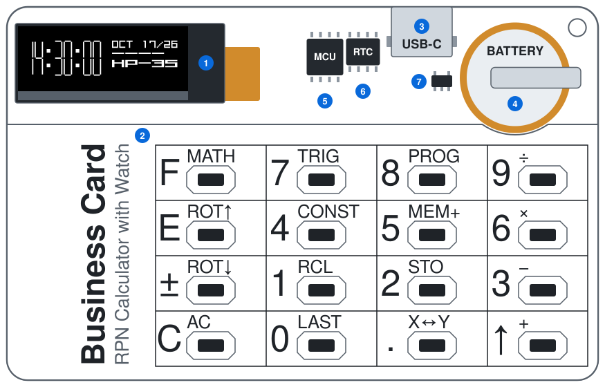
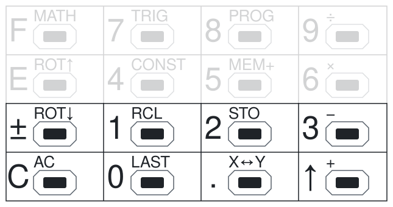
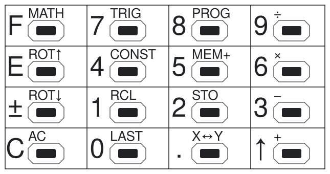

# Tiny RPN Calculator — HP-35

<details>
<summary><b>Contents</b></summary>

1. [Introduction](#1-introduction)
2. [Safety](#2-safety)
3. [Device description](#3-device-description)
4. [Power and battery](#4-power-and-battery)
5. [Operating modes](#5-operating-modes)
6. [Keyboard](#6-keyboard)
7. [Watch mode](#7-watch-mode)
8. [Calculator mode](#8-calculator-mode)
9. [Menus](#9-menus)
10. [Set the time, the date and the time zone](#10-set-the-time-the-date-and-the-time-zone)
11. [TOTP codes](#11-totp-codes)
12. [Examples](#12-examples)
13. [Troubleshooting](#13-troubleshooting)
14. [Firmware installation](#14-firmware-installation)
15. [Technical data](#15-technical-data)
16. [Quick reference](#16-quick-reference)

</details>

## 1. Introduction

This manual tells you how to use the Tiny RPN Calculator (PCB rev 1.5) with the HP-35 firmware. The device has three functions:

- An HP-35 calculator (refer to [8](#8-calculator-mode)).
- A watch (refer to [7](#7-watch-mode)).
- A generator of one-time passwords (TOTP) for two-factor authentication (refer to [11](#11-totp-codes)).

### 1.1 The HP-35 calculator

Hewlett-Packard introduced the HP-35 in 1972. It was the first pocket calculator with transcendental functions (logarithms, exponent, trigonometric functions) and with RPN (refer to [8.1](#81-rpn-and-the-stack)). At that time, most calculators, including large desktop models, had only the four arithmetic operations.

The firmware is an emulator. It runs the original ROM of the HP-35 on a virtual copy of the HP CPU, at about the speed of the original calculator. Thus, the calculations, the results and the display format are the same as on the HP-35. The firmware also adds some functions that make the calculator easier to use. This manual marks them with this label: 

For more data, refer to:

- [HP-35 Operating Manual](hp35-om-en-remake.pdf): all functions of the HP-35, with examples.
- [HP-35 page of the Museum of HP Calculators](https://www.hpmuseum.org/hp35.htm): photos and history.

### 1.2 Symbols

The text uses these symbols:

> [!NOTE]
> Data that helps you to use the device.

> [!TIP]
> A faster or easier procedure.

> [!IMPORTANT]
> Data that you must know to get the correct result.

> [!WARNING]
> A risk of injury or damage to the device.

> [!CAUTION]
> A risk of damage to the device or of incorrect operation.

In this manual, <kbd>F</kbd> <kbd>9</kbd> means: push the <kbd>F</kbd> key, release it, then push the <kbd>9</kbd> key.

## 2. Safety

> [!WARNING]
> The device has a rechargeable lithium battery.
> - Do not bend the PCB. A bent PCB can damage the battery.
> - Do not puncture, crush or heat the battery.
> - If the battery becomes swollen or hot, disconnect the USB cable immediately. Do not use the device again.
> - Charge the battery only through the USB-C connector of the device.

> [!WARNING]
> The PCB has no case. The electronic parts are open.
> - Keep the device away from water and metal objects. Metal objects can cause a short circuit.
> - Do not touch the parts with wet hands.

> [!CAUTION]
> The VCC line of the device connects directly to the battery. There is no voltage regulator.
> - Do not supply 5 V from the ICSP programmer when the battery is connected. Use a programmer that does not supply power, or set it to 3.3 V.
> - Do not connect the ICSP programmer and the USB cable at the same time.

## 3. Device description

The device has the size and the proportions of a credit card. The drawing shows the primary parts. The positions of the small parts are approximate. The drawing does not show the ICSP connector and the POWER jumper.



| No. | Part | Function |
| :---: | --- | --- |
| 1 | Display | Shows numbers, menus, time and codes (refer to [8.2](#82-display)). |
| 2 | Keyboard | 16 keys (refer to [6](#6-keyboard)). |
| 3 | USB-C connector | Connects the USB cable to charge the battery (refer to [4.1](#41-charge-the-battery)). |
| 4 | Battery | Supplies power to the device. |
| 5 | Microcontroller | Runs the firmware. |
| 6 | Real-time clock | Keeps the time and the date. |
| 7 | Charger | Charges the battery and controls the charge current. |
| — | ICSP connector | Programs the microcontroller (refer to [14](#14-firmware-installation)). |
| — | POWER jumper | Connects the battery to the circuit (refer to [4.5](#45-power-jumper-and-reset)). |

For the types of the parts, refer to [15](#15-technical-data).

> [!NOTE]
> The device has no ON/OFF switch. The firmware turns the device off automatically (refer to [4.3](#43-automatic-power-off-and-power-on)).

## 4. Power and battery

### 4.1 Charge the battery

1. Connect a USB-C cable to the device.
2. Connect the other end of the cable to a USB power supply or a computer. If the device is off, it turns on and shows the watch screen.
3. Make sure that the last bar of the battery indicator flashes. This shows that the battery charges.
4. Let the battery charge. When the charge is complete, the device turns on and shows the watch screen. The last bar does not flash.
5. Disconnect the USB cable.

> [!NOTE]
> - A full charge can take some hours.
> - During the charge, the device also turns off after 20 s (refer to [4.3](#43-automatic-power-off-and-power-on)). To look at the battery indicator again, push a key in the two bottom rows when the device is off.
> - In calculator mode and in TOTP mode, the USB connection does not change the mode. The battery indicator shows only on the watch screen.

### 4.2 Battery indicator

The watch screen shows the battery level as 0 to 5 bars (refer to [7](#7-watch-mode)).

| Indicator | Battery voltage (approximate) | Action |
| :--- | --- | --- |
| `-----` | 4.04 V or more | — |
| `---- ` | 3.92 V to 4.03 V | — |
| `---  ` | 3.80 V to 3.91 V | — |
| `--   ` | 3.68 V to 3.79 V | Charge the battery soon |
| `-    ` | 3.56 V to 3.67 V | Charge the battery |
| `     ` | less than 3.56 V | Charge the battery immediately |

### 4.3 Automatic power-off and power-on

The device saves energy with two timeouts. Each key push starts the timeouts again.

| Time after the last key push | Result |
| --- | --- |
| 10 s | The display becomes dim (calculator mode and TOTP mode). |
| 20 s | The device turns off (all modes). |

To turn on the device, push a key in one of the **two bottom rows**:



The device always starts in watch mode.

> [!IMPORTANT]
> - The keys in the two top rows do not turn on the device. The voltage from these keys is too low to start the microcontroller.
> - The key that turns on the device does not do an operation.
> - When the device is off, the calculator keeps the stack (X, Y, Z, T) and the memory. When you go back to calculator mode, you can continue your calculation.

### 4.4 Empty battery

If the battery voltage is 3.5 V or less, the device does not turn on. This prevents a deep discharge of the battery.

1. Connect the USB cable.
2. Let the battery charge for some minutes.
3. Turn on the device (refer to [4.3](#43-automatic-power-off-and-power-on)).

### 4.5 POWER jumper and reset

The POWER jumper connects the battery to the circuit. The real-time clock gets power from the same battery.

> [!IMPORTANT]
> If the microcontroller restarts, the firmware does a reset. The microcontroller restarts when you open the POWER jumper, when the battery is fully discharged and when an ICSP programmer writes or reads the device (also for the EEPROM only). The reset does these steps:
> - The clock is set to the time when the firmware was compiled.
> - The time zone is set to the default value (refer to [10.3](#103-set-the-time-zone)).
> - The calculator stack and memory are cleared.
>
> After a reset, set the time and the date again (refer to [10](#10-set-the-time-the-date-and-the-time-zone)).

## 5. Operating modes

The firmware has three operating modes:

| Mode | Display | Function |
| --- | --- | --- |
| **Watch** | Time, date, battery level | Shows the time. This is the start mode. |
| **TOTP** | 6-digit code, seconds, key label | Shows one-time passwords for two-factor authentication. |
| **Calculator** | Number in X, menus | HP-35 calculator. |

To change the mode, use these keys:

| Current mode | Keys | New mode |
| --- | --- | --- |
| Device is off | A key in the two bottom rows, USB connection or end of the charge (refer to [4.1](#41-charge-the-battery)) | Watch |
| Watch | <kbd>F</kbd> | TOTP |
| Watch | Other keys | Calculator |
| TOTP | <kbd>E</kbd> or <kbd>±</kbd> | TOTP (previous or next key) |
| TOTP | Other keys | Calculator |
| Calculator | <kbd>F</kbd> <kbd>8</kbd> <kbd>±</kbd> <kbd>1</kbd> (TOTP) | TOTP |
| Calculator | <kbd>F</kbd> <kbd>8</kbd> <kbd>1</kbd> (TIME) or <kbd>2</kbd> (DATE) | Watch |
| All modes | No key for 20 s | Device is off |

> [!NOTE]
> - In watch mode and in TOTP mode, the key that changes the mode does not do a calculator operation.
> - If there are no TOTP keys in the device, <kbd>F</kbd> in watch mode opens calculator mode.

## 6. Keyboard

### 6.1 Key layout

Each key has two functions:
- The **primary function** (large legend on the key). Push the key.
- The **shifted function** (small legend above the key). Push <kbd>F</kbd>, then push the key.



### 6.2 Primary functions

| Key | HP-35 key | Function |
| --- | --- | --- |
| <kbd>0</kbd> … <kbd>9</kbd> | <kbd>0</kbd> … <kbd>9</kbd> | Enter a digit |
| <kbd>.</kbd> | <kbd>.</kbd> | Enter the decimal point |
| <kbd>↑</kbd> | <kbd>ENTER↑</kbd> | Copy X to Y and lift the stack |
| <kbd>C</kbd> | <kbd>CLx</kbd> | Clear the X register |
| <kbd>±</kbd> | <kbd>CHS</kbd> | Change the sign of the number or of the exponent |
| <kbd>E</kbd> | <kbd>EEX</kbd> | Enter an exponent |
| <kbd>F</kbd> | — | Select the shifted function of the next key |

### 6.3 Shifted functions

| Keys | Legend | HP-35 key | Function |
| --- | --- | --- | --- |
| <kbd>F</kbd> <kbd>9</kbd> | ÷ | <kbd>÷</kbd> | Y ÷ X |
| <kbd>F</kbd> <kbd>6</kbd> | × | <kbd>×</kbd> | Y × X |
| <kbd>F</kbd> <kbd>3</kbd> | − | <kbd>−</kbd> | Y − X |
| <kbd>F</kbd> <kbd>↑</kbd> | + | <kbd>+</kbd> | Y + X |
| <kbd>F</kbd> <kbd>.</kbd> | X↔Y | <kbd>x↔y</kbd> | Exchange X and Y |
| <kbd>F</kbd> <kbd>±</kbd> | ROT↓ | <kbd>R↓</kbd> | Roll the stack down |
| <kbd>F</kbd> <kbd>E</kbd> | ROT↑ | — |  Roll the stack up |
| <kbd>F</kbd> <kbd>C</kbd> | AC | <kbd>CLR</kbd> | Clear the stack (X, Y, Z, T) and the memory |
| <kbd>F</kbd> <kbd>2</kbd> | STO | <kbd>STO</kbd> | Copy X to the memory |
| <kbd>F</kbd> <kbd>1</kbd> | RCL | <kbd>RCL</kbd> | Copy the memory to X |
| <kbd>F</kbd> <kbd>5</kbd> | MEM+ | — |  Add X to the memory |
| <kbd>F</kbd> <kbd>4</kbd> | CONST | <kbd>π</kbd> | Enter π |
| <kbd>F</kbd> <kbd>0</kbd> | LAST | — |  Do the last menu operation again |
| <kbd>F</kbd> <kbd>F</kbd> | MATH | — | Open the MATH menu |
| <kbd>F</kbd> <kbd>7</kbd> | TRIG | — | Open the TRIG menu |
| <kbd>F</kbd> <kbd>8</kbd> | PROG | — | Open the PROG menu |

> [!NOTE]
> - **MEM+** keeps the value in X. The T register gets the new memory value. The old value of T is lost.
> - **LAST** repeats only an operation that you selected in a menu (MATH, TRIG or PROG). It does not repeat the operations of the keyboard, for example <kbd>F</kbd> <kbd>↑</kbd> (+). If you did not use a menu operation before, LAST does nothing.
> - <kbd>F</kbd> <kbd>C</kbd> (AC) also clears the memory. To clear only the memory, push <kbd>C</kbd> <kbd>F</kbd> <kbd>2</kbd> (STO). This also clears X.

## 7. Watch mode

The watch screen shows:


| Element | Description |
| --- | --- |
| Time | Hours, minutes, seconds. 24-hour format. |
| Date | Month (3 letters), day, year (2 digits, 2000–2099). |
| `---- ` | Battery level, 0 to 5 bars (refer to [4.2](#42-battery-indicator)). |
| `HP-35` | Name of the firmware. |

In watch mode, the display is always dim.

## 8. Calculator mode

### 8.1 RPN and the stack

The calculator uses RPN (Reverse Polish Notation). You enter the numbers first, then the operation. Thus, you do not need parentheses and an `=` key.

In the 1920s, Jan Łukasiewicz made a notation for logic that puts the operators before or after the operands. HP changed the postfix form of this notation for a calculator keyboard and added a stack for the operands. HP named the result RPN. With RPN, you push fewer keys, and you make fewer mistakes.

For example, the expression (4 + 5) × 6 in RPN is:

```text
4 5 + 6 ×      or      6 4 5 + ×
```

**The stack**

The stack has four registers: **X**, **Y**, **Z** and **T**. The HP-35 stack operates with these rules:

- The display shows only X.
- <kbd>↑</kbd> copies X to Y. Y moves to Z, Z moves to T. The old value of T is lost.
- An operation with two numbers (for example, +) uses Y and X. The result goes to X. Then Z moves to Y, and T copies to Z. T keeps its value.
- A function with one number (for example, √x) uses only X. The result goes to X.
- The trigonometric functions (<kbd>SIN</kbd> to <kbd>ATAN</kbd>) also copy Z to T. The old value of T is lost.
- STO copies X to the memory. X does not change.
- A new number after an operation lifts the stack automatically. For example, after <kbd>5</kbd> <kbd>F</kbd> <kbd>F</kbd> <kbd>±</kbd> <kbd>1</kbd> (LOG) <kbd>1</kbd> <kbd>0</kbd>, Y contains log 5 and X contains 10.

**Example:** (4 + 5) × 6. The table shows the stack after each step.

| Keys | T | Z | Y | X |
| --- | :---: | :---: | :---: | :---: |
| <kbd>4</kbd> | 0 | 0 | 0 | **4** |
| <kbd>↑</kbd> | 0 | 0 | 4 | **4** |
| <kbd>5</kbd> | 0 | 0 | 4 | **5** |
| <kbd>F</kbd> <kbd>↑</kbd> (+) | 0 | 0 | 0 | **9** |
| <kbd>6</kbd> | 0 | 0 | 9 | **6** |
| <kbd>F</kbd> <kbd>6</kbd> (×) | 0 | 0 | 0 | **54** |

> [!NOTE]
> After <kbd>↑</kbd>, <kbd>C</kbd> and <kbd>F</kbd> <kbd>2</kbd> (STO), the next number replaces X. It does not lift the stack.

For more data about RPN, read the [HP-35 Operating Manual](hp35-om-en-remake.pdf).

### 8.2 Display

The display shows the number in X with large digits. The exponent shows with small digits at the top right.


The example shows 6.02214076 × 10²³.

- The mantissa has a sign and up to 10 digits. The display does not show zeros at the end of the mantissa.
- The exponent has a sign and 2 digits.
- A whole number shows with a decimal point, for example `128.`.
- A number less than 1 shows with no zero before the decimal point, for example `.5`.
- The calculator shows large and small numbers in scientific notation automatically.
- If a result is too large, the display shows the largest number: `9.999999999 99`.

> [!NOTE]
> During a calculation, the display is blank. Some functions, for example <kbd>SIN</kbd> and <kbd>xʸ</kbd>, take up to 0.7 s.

### 8.3 Indicators

Indicators show on the right side of the display:

| Indicator | Meaning |
| --- | --- |
| **F** (box with the letter F) | The <kbd>F</kbd> key is active. The next key does its shifted function. |
| **S** (box with the letter S, from "Store") | The memory contains a value that is not zero. |


### 8.4 Look at the Y register

When you push <kbd>F</kbd>, the display changes:


- The top line shows **Y**.
- The bottom line shows **X**.
- The digits are small.

> [!TIP]
> Push <kbd>F</kbd> to look at Y before a two-number operation. Then push the operation key.

> [!NOTE]
> You cannot cancel <kbd>F</kbd>. The next key always does its shifted function. If you pushed <kbd>F</kbd> by mistake, push <kbd>F</kbd> again (this opens the MATH menu). Then push <kbd>C</kbd> to close the menu. In a menu, <kbd>C</kbd> does not clear X (refer to [9.1](#91-use-a-menu)).
>
> <kbd>F</kbd> also ends the entry of a number. After <kbd>F</kbd> <kbd>F</kbd> <kbd>C</kbd>, the next digit starts a new number.

### 8.5 Errors

These operations are not possible:

- Division by zero.
- Square root of a negative number.
- <kbd>LN</kbd>, <kbd>LOG</kbd> or <kbd>xʸ</kbd> when X is zero or negative.
- <kbd>ASIN</kbd> or <kbd>ACOS</kbd> when X is more than 1 or less than −1.

If you try one of these operations, a flashing zero shows. To stop the error, push <kbd>C</kbd>.

### 8.6 Angles

The trigonometric functions use **degrees** only. This is the same as on the original HP-35.

## 9. Menus

### 9.1 Use a menu

A menu shows on the bottom line of the display. The top line shows X with small digits. A menu has one or two lines of three items.


| Key | Function |
| --- | --- |
| <kbd>1</kbd> <kbd>2</kbd> <kbd>3</kbd> | Do the left, the middle or the right item |
| <kbd>E</kbd> | Show the previous line of the menu |
| <kbd>±</kbd> | Show the next line of the menu |
| <kbd>F</kbd> | Open the MATH menu |
| <kbd>7</kbd> | Open the TRIG menu |
| <kbd>8</kbd> | Open the PROG menu |
| Other keys | Close the menu. No operation occurs. |

> [!TIP]
> To do the same menu operation again, push <kbd>F</kbd> <kbd>0</kbd> (LAST). You do not need to open the menu again.

### 9.2 MATH menu: <kbd>F</kbd> <kbd>F</kbd>

| Keys in the menu | Item | Function |
| --- | :---: | --- |
| <kbd>1</kbd> | <kbd>xʸ</kbd> | X to the power Y |
| <kbd>2</kbd> | <kbd>√x</kbd> | Square root of X |
| <kbd>3</kbd> | <kbd>1/x</kbd> | Reciprocal of X |
| <kbd>±</kbd> <kbd>1</kbd> | <kbd>LOG</kbd> | Common logarithm of X |
| <kbd>±</kbd> <kbd>2</kbd> | <kbd>LN</kbd> | Natural logarithm of X |
| <kbd>±</kbd> <kbd>3</kbd> | <kbd>eˣ</kbd> | e to the power X |

> [!IMPORTANT]
> <kbd>xʸ</kbd> calculates **X to the power Y**. This is the order of the original HP-35:
> 1. Enter the power. Push <kbd>↑</kbd> to move it to Y.
> 2. Enter the number. It stays in X.
> 3. Do <kbd>xʸ</kbd>.
>
> For example, 2⁷ = 128: push <kbd>7</kbd> <kbd>↑</kbd> <kbd>2</kbd>, then <kbd>F</kbd> <kbd>F</kbd> <kbd>1</kbd> (xʸ).
>
> The number in X must be more than zero. The power in Y can be any number. The result is not always exact in the last digit, because the HP-35 uses logarithms for this calculation.

### 9.3 TRIG menu: <kbd>F</kbd> <kbd>7</kbd>

| Keys in the menu | Item | Function |
| --- | :---: | --- |
| <kbd>1</kbd> | <kbd>SIN</kbd> | Sine of X |
| <kbd>2</kbd> | <kbd>COS</kbd> | Cosine of X |
| <kbd>3</kbd> | <kbd>TAN</kbd> | Tangent of X |
| <kbd>±</kbd> <kbd>1</kbd> | <kbd>ASIN</kbd> | Arc sine of X |
| <kbd>±</kbd> <kbd>2</kbd> | <kbd>ACOS</kbd> | Arc cosine of X |
| <kbd>±</kbd> <kbd>3</kbd> | <kbd>ATAN</kbd> | Arc tangent of X |

### 9.4 PROG menu: <kbd>F</kbd> <kbd>8</kbd>

| Keys in the menu | Item | Function |
| --- | :---: | --- |
| <kbd>1</kbd> | <kbd>TIME</kbd> | Set the time (refer to [10.1](#101-set-the-time)) |
| <kbd>2</kbd> | <kbd>DATE</kbd> | Set the date (refer to [10.2](#102-set-the-date)) |
| <kbd>3</kbd> | <kbd>ZONE</kbd> | Set the time zone (refer to [10.3](#103-set-the-time-zone)) |
| <kbd>±</kbd> <kbd>1</kbd> | <kbd>TOTP</kbd> | Show the TOTP codes (refer to [11](#11-totp-codes)) |

## 10. Set the time, the date and the time zone

> [!IMPORTANT]
> - Enter **whole numbers** in the range of the table. Do not enter a decimal fraction or an exponent.
> - If a value is not correct, the operation does not change the clock and the time zone. The calculator shows an error and **clears the stack** (X, Y, Z, T). The memory does not change. Push <kbd>C</kbd> and do the procedure again.
> - If the values are correct, the operation removes them from the stack. After <kbd>TIME</kbd> and <kbd>DATE</kbd>, the device shows the watch screen. After <kbd>ZONE</kbd>, the device stays in calculator mode.

### 10.1 Set the time

| Register | Value | Range |
| --- | --- | --- |
| Z | Hours | 0 to 23 |
| Y | Minutes | 0 to 59 |
| X | Seconds | 0 to 59 |

**Procedure** (example: 14:30:00):

1. Enter the hours: <kbd>1</kbd> <kbd>4</kbd> <kbd>↑</kbd>.
2. Enter the minutes: <kbd>3</kbd> <kbd>0</kbd> <kbd>↑</kbd>.
3. Enter the seconds: <kbd>0</kbd>.
4. Push <kbd>F</kbd> <kbd>8</kbd> to open the PROG menu.
5. Push <kbd>1</kbd> (TIME) at the moment when the time is correct.
6. Make sure that the watch screen shows the correct time.

> [!TIP]
> To set the time precisely, do steps 1 to 4 some seconds before the specified time. Push <kbd>1</kbd> at the correct second.

### 10.2 Set the date

| Register | Value | Range |
| --- | --- | --- |
| Z | Day | 1 to 31 (the firmware checks the number of days in the month and leap years) |
| Y | Month | 1 to 12 |
| X | Year | 0 to 99 (2000 to 2099) |

**Procedure** (example: 17 October 2026):

1. Enter the day: <kbd>1</kbd> <kbd>7</kbd> <kbd>↑</kbd>.
2. Enter the month: <kbd>1</kbd> <kbd>0</kbd> <kbd>↑</kbd>.
3. Enter the year: <kbd>2</kbd> <kbd>6</kbd>.
4. Push <kbd>F</kbd> <kbd>8</kbd>, then <kbd>2</kbd> (DATE).
5. Make sure that the watch screen shows the correct date.

> [!NOTE]
> The <kbd>DATE</kbd> operation does not change the time. The <kbd>TIME</kbd> operation does not change the date.

### 10.3 Set the time zone

The clock keeps the **local time**. The TOTP function needs UTC time. The time zone tells the firmware the difference between the local time and UTC.

| Register | Value | Range |
| --- | --- | --- |
| X | Hours from UTC | −14 to +14 |

**Procedure** (example: UTC+2):

1. Enter the time zone: <kbd>2</kbd>.
2. For a negative time zone, push <kbd>±</kbd>.
3. Push <kbd>F</kbd> <kbd>8</kbd>, then <kbd>3</kbd> (ZONE).

> [!IMPORTANT]
> - The default time zone is **UTC+3**. After a reset, the device uses this value again (refer to [4.5](#45-power-jumper-and-reset)).
> - The time zone has full hours only.
> - The time zone does not change the watch screen. It changes only the TOTP codes.
> - The device does not change to summer time automatically. When your local time changes, set the time and the time zone again.

## 11. TOTP codes

### 11.1 Description

TOTP (Time-based One-Time Password, RFC 6238) is a 6-digit code for two-factor authentication. Many web sites and applications use it, as an authenticator application on a phone does. A new code shows each 30 seconds.


The device keeps the keys in a keys area of 126 bytes: 5 bytes for the header and 121 bytes for the keys. Each key uses 5 bytes plus the length of its secret. Thus, the number of keys is related to the length of the secrets:

| Secret (Base32 characters) | Secret (bytes) | Bytes for each key | Maximum number of keys |
| :---: | :---: | :---: | :---: |
| 16 | 10 | 15 | 8 |
| 26 | 16 | 21 | 5 |
| 32 | 20 | 25 | 4 |
| 52 | 32 | 37 | 3 |

You can use secrets of different lengths together. The `totp` tool tells you the number of bytes that your keys use, with the header. If the keys are too large for the area, the tool shows an error.

### 11.2 Show the codes

1. Do one of these steps:
   - In watch mode, push <kbd>F</kbd>.
   - In calculator mode, push <kbd>F</kbd> <kbd>8</kbd>, then <kbd>±</kbd>, then <kbd>1</kbd> (TOTP).
2. Read the label of the key. Make sure that it is the correct key.
3. To show the next key, push <kbd>±</kbd>. To show the previous key, push <kbd>E</kbd>. After the last key, <kbd>±</kbd> shows the first key again.
4. Enter the code in the web site or the application.
5. Push another key to go to calculator mode, or let the device turn off.

> [!TIP]
> If only some seconds are left, wait for the new code. Then you have more time to enter it.

> [!IMPORTANT]
> The codes are correct only if:
> - The time is correct (±30 s).
> - The date is correct.
> - The time zone is correct.
>
> If a web site does not accept the code, examine the time, the date and the time zone first.

### 11.3 Install your TOTP keys

The TOTP keys are in the EEPROM of the microcontroller. To install your keys, you need a computer and an ICSP programmer.

1. Get the secret of each key. The web site gives it as a Base32 text or as an `otpauth://` link (QR code) when you enable two-factor authentication.
2. Write the keys in the file `firmware/sketches/hp35/data/totp.local.txt`. Use one line for each key: label, then secret.
   ```text
   # label  secret (Base32 or otpauth:// URI)
   MAIL     JBSWY3DPEHPK3PXP
   BANK     otpauth://totp/Bank:me?secret=KRSXG5CTMVRXEZLU&issuer=Bank
   ```
3. Compile the firmware (refer to [14](#14-firmware-installation), steps 1 to 5). This makes the file `hp35.ino.eep`.
4. Run `firmware/tools/totp/totp_hp35.bat`. The tool writes the file `firmware/sketches/hp35/build/hp35.totp.eep`.
5. Flash `hp35.ino.hex` and `hp35.totp.eep` to the device (refer to [14](#14-firmware-installation)).
6. Set the time, the date and the time zone again.

> [!TIP]
> The tool also shows the current codes of your keys. Compare them with the codes of your authenticator application. If the codes are the same, the secrets are correct.

> [!WARNING]
> - The TOTP secrets are not encrypted in the device. A person with an ICSP programmer can read them. Keep the device in a safe place.
> - Do not put real secrets in `data/totp.txt`. This file is in the git repository. The file `totp.local.txt` is not in the repository.
> - Keep a backup of your secrets or recovery codes in another place.

> [!NOTE]
> - Only HMAC-SHA1 keys with 6 digits and a 30-second period are supported. Most web sites use these settings. The tool does not accept an `otpauth://` link with other settings.
> - A label has 1 to 4 characters: the letters A–Z and the digits 0–9. The tool changes lowercase letters to uppercase.
> - The default firmware contains 4 test keys (`KEY1` to `KEY4`). They are not real keys.

## 12. Examples

<details>
<summary><b>Example 1: Area of a circle with a radius of 2.5</b></summary>

Calculate π × 2.5².

| Step | Keys | HP-35 keys | Display (X) |
| :---: | --- | --- | --- |
| 1 | <kbd>2</kbd> <kbd>.</kbd> <kbd>5</kbd> | <kbd>2</kbd> <kbd>.</kbd> <kbd>5</kbd> | `2.5` |
| 2 | <kbd>↑</kbd> | <kbd>ENTER↑</kbd> | `2.5` |
| 3 | <kbd>F</kbd> <kbd>6</kbd> (×) | <kbd>×</kbd> | `6.25` |
| 4 | <kbd>F</kbd> <kbd>4</kbd> (CONST) | <kbd>π</kbd> | `3.141592654` |
| 5 | <kbd>F</kbd> <kbd>6</kbd> (×) | <kbd>×</kbd> | `19.63495409` |

</details>

<details>
<summary><b>Example 2: Sine of 30°, cosine of 60° and 45° (LAST)</b></summary>

| Step | Keys | HP-35 keys | Display (X) |
| :---: | --- | --- | --- |
| 1 | <kbd>3</kbd> <kbd>0</kbd> | <kbd>3</kbd> <kbd>0</kbd> | `30.` |
| 2 | <kbd>F</kbd> <kbd>7</kbd> <kbd>1</kbd> (SIN) | <kbd>sin</kbd> | `.5` |
| 3 | <kbd>6</kbd> <kbd>0</kbd> | <kbd>6</kbd> <kbd>0</kbd> | `60.` |
| 4 | <kbd>F</kbd> <kbd>7</kbd> <kbd>2</kbd> (COS) | <kbd>cos</kbd> | `.5000000001` |
| 5 | <kbd>4</kbd> <kbd>5</kbd> | <kbd>4</kbd> <kbd>5</kbd> | `45.` |
| 6 | <kbd>F</kbd> <kbd>0</kbd> (LAST = COS) | <kbd>cos</kbd> | `.7071067814` |

> [!NOTE]
> The last digit of cos 60° and cos 45° is not exact. The original HP-35 gives the same results.

</details>

<details>
<summary><b>Example 3: Powers with xʸ</b></summary>

Calculate 2⁷ and 8^(2/3).

| Step | Keys | HP-35 keys | Display (X) | Comment |
| :---: | --- | --- | --- | --- |
| 1 | <kbd>7</kbd> <kbd>↑</kbd> | <kbd>7</kbd> <kbd>ENTER↑</kbd> | `7.` | The power goes to Y |
| 2 | <kbd>2</kbd> | <kbd>2</kbd> | `2.` | The number is in X |
| 3 | <kbd>F</kbd> <kbd>F</kbd> <kbd>1</kbd> (xʸ) | <kbd>xʸ</kbd> | `128.` | 2⁷ |
| 4 | <kbd>2</kbd> <kbd>↑</kbd> <kbd>3</kbd> <kbd>F</kbd> <kbd>9</kbd> (÷) | <kbd>2</kbd> <kbd>ENTER↑</kbd> <kbd>3</kbd> <kbd>÷</kbd> | `.6666666667` | The power 2/3 |
| 5 | <kbd>↑</kbd> | <kbd>ENTER↑</kbd> | `.6666666667` | The power goes to Y |
| 6 | <kbd>8</kbd> | <kbd>8</kbd> | `8.` | The number is in X |
| 7 | <kbd>F</kbd> <kbd>F</kbd> <kbd>1</kbd> (xʸ) | <kbd>xʸ</kbd> | `3.999999999` | 8^(2/3) = 4. The HP-35 uses logarithms, thus the last digit is not exact. This example is from the HP-35 Operating Manual. |

</details>

<details>
<summary><b>Example 4: Sum in the memory (MEM+)</b></summary>

Add 12.5, 7.25 and 30 in the memory. The HP-35 has no MEM+, thus it uses <kbd>RCL</kbd> <kbd>+</kbd> <kbd>STO</kbd>.

| Step | Keys | HP-35 keys | Result |
| :---: | --- | --- | --- |
| 1 | <kbd>C</kbd> <kbd>F</kbd> <kbd>2</kbd> (STO) | <kbd>CLx</kbd> <kbd>STO</kbd> | Memory = 0 |
| 2 | <kbd>1</kbd> <kbd>2</kbd> <kbd>.</kbd> <kbd>5</kbd> <kbd>F</kbd> <kbd>5</kbd> (MEM+) | <kbd>1</kbd> <kbd>2</kbd> <kbd>.</kbd> <kbd>5</kbd> <kbd>RCL</kbd> <kbd>+</kbd> <kbd>STO</kbd> | Memory = 12.5 |
| 3 | <kbd>7</kbd> <kbd>.</kbd> <kbd>2</kbd> <kbd>5</kbd> <kbd>F</kbd> <kbd>5</kbd> (MEM+) | <kbd>7</kbd> <kbd>.</kbd> <kbd>2</kbd> <kbd>5</kbd> <kbd>RCL</kbd> <kbd>+</kbd> <kbd>STO</kbd> | Memory = 19.75 |
| 4 | <kbd>3</kbd> <kbd>0</kbd> <kbd>F</kbd> <kbd>5</kbd> (MEM+) | <kbd>3</kbd> <kbd>0</kbd> <kbd>RCL</kbd> <kbd>+</kbd> <kbd>STO</kbd> | Memory = 49.75 |
| 5 | <kbd>F</kbd> <kbd>1</kbd> (RCL) | <kbd>RCL</kbd> | X = `49.75` |

</details>

<details>
<summary><b>Example 5: Hypotenuse √(3² + 4²)</b></summary>

| Step | Keys | HP-35 keys | Display (X) |
| :---: | --- | --- | --- |
| 1 | <kbd>3</kbd> <kbd>↑</kbd> <kbd>F</kbd> <kbd>6</kbd> (×) | <kbd>3</kbd> <kbd>ENTER↑</kbd> <kbd>×</kbd> | `9.` |
| 2 | <kbd>4</kbd> <kbd>↑</kbd> <kbd>F</kbd> <kbd>6</kbd> (×) | <kbd>4</kbd> <kbd>ENTER↑</kbd> <kbd>×</kbd> | `16.` |
| 3 | <kbd>F</kbd> <kbd>↑</kbd> (+) | <kbd>+</kbd> | `25.` |
| 4 | <kbd>F</kbd> <kbd>F</kbd> <kbd>2</kbd> (√x) | <kbd>√x</kbd> | `5.` |

</details>

## 13. Troubleshooting

| Problem | Possible cause | Action |
| --- | --- | --- |
| The device does not turn on. | You pushed a key in the two top rows. | Push a key in the two bottom rows (refer to [4.3](#43-automatic-power-off-and-power-on)). |
| | The battery is empty. | Charge the battery (refer to [4.1](#41-charge-the-battery)). |
| | The POWER jumper is open. | Close the jumper. Then set the time, the date and the time zone. |
| The time or the date is not correct. | A reset occurred (refer to [4.5](#45-power-jumper-and-reset)). | Set the time, the date and the time zone (refer to [10](#10-set-the-time-the-date-and-the-time-zone)). |
| <kbd>TIME</kbd>, <kbd>DATE</kbd> or <kbd>ZONE</kbd> shows an error. | A value is not in the range, or is not a whole number. | Push <kbd>C</kbd>. Do the procedure again with correct values. |
| The web site does not accept the TOTP code. | The time, the date or the time zone is not correct. | Set the time, the date and the time zone again. |
| | The key label is not correct. | Push <kbd>±</kbd> or <kbd>E</kbd> to select the correct key. |
| <kbd>F</kbd> in watch mode opens calculator mode. | The device has no TOTP keys. | Install the TOTP keys (refer to [11.3](#113-install-your-totp-keys)). |
| The display is dim. | 10 s passed after the last key push. | Push a key. |
| The battery indicator does not flash during the charge. | The battery is full. | No action is necessary. |
| | The USB cable or the power supply is defective. | Use a different cable or power supply. |
| A zero flashes on the display. | An error occurred in a calculation. | Push <kbd>C</kbd>. |
| <kbd>xʸ</kbd> gives an incorrect result. | The power and the number are in the wrong registers. | Enter the power first, then the number (refer to [9.2](#92-math-menu-f-f)). |
| <kbd>F</kbd> <kbd>0</kbd> (LAST) does not repeat an arithmetic operation. | LAST repeats only menu operations. | Push the arithmetic keys again. |
| A key does an incorrect function. | <kbd>F</kbd> is active (indicator F shows). | Look at the indicators before you push a key. |

## 14. Firmware installation

> [!NOTE]
> This section is for persons who build or update the device. Normal users do not need it.

<details>
<summary><b>Procedure</b></summary>

**Tools and materials:**

- [ ] Computer with Windows and Arduino IDE
- [ ] ATTinyCore board package
- [ ] avrdude (it comes with the Arduino IDE)
- [ ] ICSP programmer (for example, USBasp) and a 6-pin cable

**Procedure:**

1. Run `firmware/libraries/TinyRPNCalculator_Install.bat` as administrator.
2. Open `firmware/sketches/hp35/hp35.ino` in the Arduino IDE.
3. Make sure that the sketch selects PCB rev 1.5:
   ```cpp
   #define  PCB_REVISION        15
   ```
   With a different value, the display, the charge indicator and the power-on from USB do not operate correctly.
4. Set the board options:

   | Option | Value |
   | --- | --- |
   | Board | ATtiny25/45/85 (No bootloader) |
   | Chip | ATtiny85 |
   | Clock | 16 MHz (PLL) |
   | LTO | Enabled |
   | millis()/micros() | Disabled |
   | Save EEPROM | EEPROM retained |
   | B.O.D. | Disabled |

5. Select **Sketch → Export compiled binary**. The files go to `firmware/sketches/hp35/build/`.
6. Connect the ICSP programmer to the ICSP connector of the device. Make sure that the programmer does not supply 5 V (refer to [2](#2-safety)).
7. Open a command prompt in the folder `firmware/sketches/hp35/build/`.
8. Write the fuses: High `0xD7`, Low `0xF1`, Extended `0xFF`. For example, with a USBasp:
   ```text
   avrdude -c usbasp -p t85 -B 32 -U lfuse:w:0xF1:m -U hfuse:w:0xD7:m -U efuse:w:0xFF:m
   ```
   `-B 32` makes the programmer slower. A new microcontroller needs it, because it runs at 1 MHz before you write the fuses.
9. Write **both** files: the flash `hp35.ino.hex` and the EEPROM `hp35.ino.eep`. With your TOTP keys, use `hp35.totp.eep` (refer to [11.3](#113-install-your-totp-keys)).
   ```text
   avrdude -c usbasp -p t85 -U flash:w:hp35.ino.hex:i -U eeprom:w:hp35.ino.eep:i
   ```
10. Disconnect the programmer.
11. Set the time, the date and the time zone (refer to [10](#10-set-the-time-the-date-and-the-time-zone)).

> [!CAUTION]
> You must write the EEPROM file too. The firmware keeps the menus, the key tables and the TOTP keys in the EEPROM. If you write only the `.hex` file, the device does not operate correctly.

</details>

## 15. Technical data

| Parameter | Value |
| --- | --- |
| Dimensions | 85.5 × 54 mm (PCB), the size of a credit card |
| Microcontroller | [ATtiny85](../../datasheets/ATtiny85.pdf), 16 MHz (internal PLL), 8 KB flash, 512 B RAM, 512 B EEPROM |
| Display | OLED 0.91 inch, 128 × 32, [SSD1306](../../datasheets/SSD1306.pdf), I²C |
| Real-time clock | [DS3231M](../../datasheets/DS3231M.pdf), I²C, temperature-compensated |
| Keyboard | 16 keys on one analog input (resistor ladder) |
| Battery | Rechargeable lithium-ion coin battery, 3.5 V to 4.2 V: [LIR1620](../../datasheets/LIR1620.pdf) (20 mAh, default) or LIR1632 |
| Battery protection | XB5358D0 |
| Charger | [MCP73832](../../datasheets/MCP73831.pdf), 4.2 V, 15 mA, from USB-C (5 V) |
| Schematic | [Tiny-RPN-Calculator-rev1.5_Schematic.pdf](../../hardware/pcb-rev1.5/Tiny-RPN-Calculator-rev1.5_Schematic.pdf) |

## 16. Quick reference

**Keyboard**


**Menus**

The top row shows the keys that open each menu. The left column shows the keys that select an item in the open menu. <kbd>±</kbd> shows line 2 of the menu, <kbd>E</kbd> shows line 1 again.

| Keys in the menu | MATH<br><kbd>F</kbd> <kbd>F</kbd> | TRIG<br><kbd>F</kbd> <kbd>7</kbd> | PROG<br><kbd>F</kbd> <kbd>8</kbd> |
| --- | :---: | :---: | :---: |
| <kbd>1</kbd> | <kbd>xʸ</kbd> | <kbd>SIN</kbd> | <kbd>TIME</kbd> |
| <kbd>2</kbd> | <kbd>√x</kbd> | <kbd>COS</kbd> | <kbd>DATE</kbd> |
| <kbd>3</kbd> | <kbd>1/x</kbd> | <kbd>TAN</kbd> | <kbd>ZONE</kbd> |
| <kbd>±</kbd> <kbd>1</kbd> | <kbd>LOG</kbd> | <kbd>ASIN</kbd> | <kbd>TOTP</kbd> |
| <kbd>±</kbd> <kbd>2</kbd> | <kbd>LN</kbd> | <kbd>ACOS</kbd> | — |
| <kbd>±</kbd> <kbd>3</kbd> | <kbd>eˣ</kbd> | <kbd>ATAN</kbd> | — |

**Stack input for the operations**

| Operation | Z | Y | X |
| --- | --- | --- | --- |
| <kbd>TIME</kbd> | Hours (0–23) | Minutes (0–59) | Seconds (0–59) |
| <kbd>DATE</kbd> | Day (1–31) | Month (1–12) | Year (0–99) |
| <kbd>ZONE</kbd> | — | — | Hours from UTC (−14 to +14) |
| <kbd>xʸ</kbd> | — | Power | Number (more than 0) |

**Modes and power**

| Item | Keys or time |
| --- | --- |
| Turn on | A key in the two bottom rows |
| Watch → TOTP | <kbd>F</kbd> |
| Watch or TOTP → Calculator | Other keys |
| TOTP: previous / next key | <kbd>E</kbd> / <kbd>±</kbd> |
| Display becomes dim | 10 s |
| Device turns off | 20 s |
