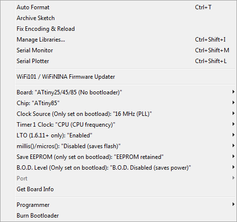
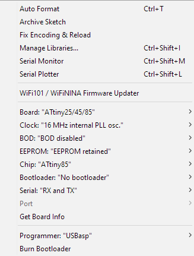

# TinyRPNCalculator Library

TinyRPNCalculator is an Arduino library for the Tiny RPN Calculator hardware platform, the PCB of the **Business Card RPN Calculator with Watch**. On a board of the size of a credit card, the device has an ATtiny85 microcontroller, a 128 × 32 OLED display, a real-time clock, 16 keys and a rechargeable coin battery.

The library gives a sketch everything it needs to use this hardware. It draws text on the display, reads the keys and the clock, measures the battery and puts the device to sleep when nobody uses it. It also contains virtual machines that run the original ROMs of HP calculators, and SHA-1 code for one-time passwords. The firmware of the device is built on this library.

## Contents

1. [Design](#1-design)
2. [Hardware](#2-hardware)
3. [Installation](#3-installation)
4. [Getting started](#4-getting-started)
5. [Examples](#5-examples)
6. [Module reference](#6-module-reference)
7. [Extras](#7-extras)
8. [Limits](#8-limits)
9. [License](#9-license)

## 1. Design

The ATtiny85 has only 8 KB of flash memory, 512 bytes of RAM and 512 bytes of EEPROM. An emulator of an HP calculator together with its ROM takes about half of the flash, so every byte counts. For this reason the library follows a few simple rules:

- **Header-only.** You include one header, and the compiler sees all the code at once. The compiler and the linker then remove every function and table that the sketch does not use. A sketch pays only for what it calls.
- **Namespaces, not classes.** Each module is a namespace with free functions and global variables. There are no objects, constructors, virtual functions or heap allocations. You call `LCD::Clear()` directly, and you read the clock as the plain variable `RTC::Hours`.
- **No Arduino API.** The library does not use `pinMode()`, `millis()` or `Wire`. It writes to the registers of the microcontroller directly. This is smaller, and it gives full control of the sleep modes.
- **Size options.** Two compile-time options move constant data to the EEPROM and replace inline code with calls (refer to [4.2](#42-compile-time-options)).

The library has these modules:

- [`SYS`](#61-sys-system): initialization of all modules, power-down of the device.
- [`TMR`](#62-tmr-frame-timer): frame timer on the watchdog, time in milliseconds.
- [`PWR`](#63-pwr-power): sleep modes, battery voltage and level, charging state.
- [`KBD`](#64-kbd-keyboard): 16 keys on one analog input.
- [`LCD`](#65-lcd-display): SSD1306 display controller with two screen buffers.
- [`TXT`](#66-txt-text): text with custom fonts, scale and inverse, 7-segment digits.
- [`FNT`](#67-fnt-fonts): the built-in 5 × 8 font.
- [`RTC`](#68-rtc-real-time-clock): DS3231M real-time clock: time, date, temperature, Unix time.
- [`I2C`](#69-i2c-bus): I2C bus master in software.
- [`ADC`](#610-adc-analog-to-digital-converter): analog-to-digital converter with noise reduction sleep.
- [`BCD`](#611-bcd-binary-coded-decimals): packed binary-coded decimals.
- [`MEM`](#612-mem-constant-data): constant data in the flash or in the EEPROM.

The extras are optional headers for the firmware level: [`HPVM`](#71-hpvm-hp-virtual-machine) (HP-35 and HP-21 virtual machines), [`SHA1` and `TOTP`](#72-sha1-and-totp) (one-time passwords) and [`BuildTime`](#73-buildtime).

## 2. Hardware

The library supports one board: the Tiny RPN Calculator PCB rev 1.5 with an ATtiny85 at 16 MHz. The clock comes from the internal PLL, so the board has no crystal. If the board settings in the IDE select a different microcontroller or clock, the compilation stops with an error.

The library uses all the pins of the microcontroller. The signal names are the net names of the schematic:

```text
                      ATtiny85
                  +------\/------+
   RESET    PB5 --| 1          8 |-- VCC
   CHRG     PB3 --| 2          7 |-- PB2    SCK  = SCL
   KBD      PB4 --| 3          6 |-- PB1    MISO = OLED_RES
            GND --| 4          5 |-- PB0    MOSI = SDA
                  +--------------+
```

PB0, PB1 and PB2 have two names each. During programming they are the ICSP signals MOSI, MISO and SCK. When the sketch runs, they are the I2C bus and the display reset.

- **SDA, SCL** are the I2C bus. The bus has two devices: the SSD1306 display controller at address `0x3C` and the DS3231M real-time clock at address `0x68`. The 4.7 kΩ pull-up resistors are on the PCB.
- **OLED_RES** goes to the RES input of the display controller. `LCD::Init()` pulses it low before it configures the display.
- **KBD** is the output of the resistor network of the keyboard. The ADC reads it on channel ADC2. A key push also wakes up the microcontroller through this pin.
- **CHRG** is the STAT output of the MCP73832 charger. It is an open-drain output: the charger pulls it low while it charges the battery. A change of the status also wakes up the microcontroller.
- **RESET** is used only for programming through the ICSP connector.
- **VCC** is the battery voltage: there is no voltage regulator. VCC changes from approximately 4.2 V (full battery) to 3.5 V (empty battery).

The library uses three interrupt vectors: `ADC_vect`, `WDT_vect` and `PCINT0_vect`. Do not define them in a sketch. Timer 0 and timer 1 are free: the library does not use them.

## 3. Installation

### 3.1 Install the library

On Windows, run [`TinyRPNCalculator_Install.bat`](../TinyRPNCalculator_Install.bat) as administrator. The script makes the symbolic link `Documents\Arduino\libraries\TinyRPNCalculator` to the library folder. The Arduino IDE then compiles the library directly from this folder, and every change in the library has an effect on the next build. Restart the IDE after the installation.

On other systems, copy the library folder to the `libraries` folder of your Arduino sketchbook, or make a symbolic link there.

### 3.2 Install the board package

The library works with two board packages. Add the URL of the package in **File → Preferences → Additional Boards Manager URLs**, and then install the package with **Tools → Board → Boards Manager**.

- ATTinyCore 1.5.2: `http://drazzy.com/package_drazzy.com_index.json`
- TinyCore 0.8.0 (MCUdude): `https://mcudude.github.io/TinyCore/package_MCUdude_TinyCore_index.json`

### 3.3 Set the board options

For **ATTinyCore**, select:

- Board: **ATtiny25/45/85 (No bootloader)**, Chip: **ATtiny85**
- Clock Source: **16 MHz (PLL)**, Timer 1 Clock: **CPU (CPU frequency)**
- LTO: **Enabled**, millis()/micros(): **Disabled (saves flash)**
- Save EEPROM: **EEPROM retained**, B.O.D. Level: **B.O.D. Disabled (saves power)**

<details>
<summary>Screenshot of the ATTinyCore options</summary>

</details>

For **TinyCore**, select:

- Board: **ATtiny25/45/85**, Chip: **ATtiny85**, Bootloader: **No bootloader**
- Clock: **16 MHz internal PLL osc.**
- BOD: **BOD disabled**, EEPROM: **EEPROM retained**

<details>
<summary>Screenshot of the TinyCore options</summary>

</details>

### 3.4 Program the device

The device has a standard 6-pin AVR ICSP connector. Any ICSP programmer that avrdude supports is good, for example a USBasp.

> [!CAUTION]
> VCC of the device connects directly to the battery. Do not supply 5 V from the programmer: use a programmer that does not supply power, or set it to 3.3 V. Do not connect the programmer and the USB cable at the same time.

A new ATtiny85 needs the fuses first:

```text
avrdude -c usbasp -p t85 -B 32 -U lfuse:w:0xF1:m -U hfuse:w:0xD7:m -U efuse:w:0xFF:m
```

- Low `0xF1` selects the 16 MHz PLL clock without the divider by 8.
- High `0xD7` keeps SPI programming on and the RESET pin as reset, keeps the EEPROM during a chip erase and turns off the brown-out detector (it saves power).
- Extended `0xFF` is the default value.

A new microcontroller runs at 1 MHz before you write the fuses. The option `-B 32` makes the programmer slow enough for it.

To program a sketch, select **Sketch → Export compiled binary**. The IDE puts the files into the `build` folder of the sketch. Then write the flash, and the EEPROM if the sketch uses `ENABLE_OPT_DATAMEM`:

```text
avrdude -c usbasp -p t85 -U flash:w:MySketch.ino.hex:i -U eeprom:w:MySketch.ino.eep:i
```

> [!IMPORTANT]
> With `ENABLE_OPT_DATAMEM`, a part of the constant data is in the `.eep` file. If you write only the `.hex` file, the sketch reads old or empty EEPROM data and does not operate correctly.

## 4. Getting started

### 4.1 First sketch

This sketch shows a text and then waits in a loop of frames:

```cpp
#define PCB_REVISION 15

#include <TinyRPNCalculator.h>

int main()
{
    SYS::Init();
    LCD::TurnOn();
    TMR::Start(TMR::TIMEOUT_64MS);

    LCD::Clear();
    TXT::SetFont(FNT::Font5x8);
    TXT::PrintString(F("Hello!"), 0, 0);
    LCD::Flip();

    while (true)
    {
        // read the keys, update the state, draw the screen
        TMR::Sync();
    }
    return 0;
}
```

There are some things to note here:

- The sketch defines its own `int main()`, not `setup()` and `loop()`. Thus, the Arduino core does not start its timer, and no timer interrupt wakes up the microcontroller between the frames. All the examples use this structure.
- `SYS::Init()` must be the first call. It prepares all the modules, but it does not turn on the display and does not start the timer: the sketch does this when it is ready.
- Text goes to a hidden screen buffer. The user sees it only after `LCD::Flip()` (refer to [6.5](#65-lcd-display)).
- `TMR::Sync()` puts the microcontroller into sleep until the next frame. The device is in sleep for most of the time, and this saves the battery.

### 4.2 Compile-time options

Define the options in the sketch before the line `#include <TinyRPNCalculator.h>`:

```cpp
#define PCB_REVISION        15 // PCB rev 1.5, always set it
#define ENABLE_OPT_DATAMEM  1  // DATAMEM data in the EEPROM (default 0)
#define ENABLE_OPT_NOINLINE 1  // NOINLINE functions are calls (default 0)

#include <TinyRPNCalculator.h>
```

`PCB_REVISION` selects the board. The value `15` is PCB rev 1.5: OLED_RES is on PB1 and CHRG is on PB3. Always set this value: the default value `14` is not for PCB rev 1.5, and with it the display and the charging state do not operate correctly.

`ENABLE_OPT_DATAMEM` moves the small constant tables of the sketch and the library from the flash to the EEPROM. For example, a calculator firmware can keep several hundred bytes of key maps, menus and strings there. The cost: you must write the `.eep` file too, and an EEPROM read is a little slower. Refer to [4.4](#44-constant-data).

`ENABLE_OPT_NOINLINE` makes the functions with the `NOINLINE` mark real calls. Without it the compiler can copy their code into each place of use. With it the code becomes smaller and a little slower.

### 4.3 Frames and power

A sketch does its work in frames of a fixed time, for example 64 ms. In each frame it reads the keys, updates its state and draws the screen if something changed. Then it calls `TMR::Sync()` and sleeps until the next frame.

The device has no ON/OFF switch, so the sketch must turn it off. The usual method is a timeout after the last key push:

```cpp
void powerUp()
{
    LCD::TurnOn();
    TMR::Start(TMR::TIMEOUT_64MS);
}

int main()
{
    SYS::Init();
    powerUp();

    u08 last = KBD::Read();
    while (true)
    {
        u08 key = KBD::Read();

        // each key push starts the timer again, thus
        // TMR::Millis is the time after the last key push
        if (key != KBD::NONE) TMR::Start(TMR::TIMEOUT_64MS);

        if (TMR::Millis >= 20000)
        {
            SYS::Down(); // sleeps until a key push
            powerUp();

            // the key that woke up the device is still pushed:
            // remember it, so that it does not do an operation
            last = KBD::Read();
            continue;
        }

        if (key != last && key != KBD::NONE)
        {
            // a new key push: do the operation of the key
        }
        last = key;

        TMR::Sync();
    }
    return 0;
}
```

`SYS::Down()` stops the timer, turns off the display and stops the microcontroller in power-down sleep. In this mode the device uses almost no energy, but the RAM keeps all its data. When the user pushes a key, `SYS::Down()` returns, and the sketch continues with the same state. Only the display and the timer must be started again.

Not all keys can wake up the device. In power-down sleep the microcontroller sees only a logic level on PB4, and a pin is sure to read as high only above 0.6 × VCC. Only the keys of the two bottom rows (<kbd>±</kbd> <kbd>1</kbd> <kbd>2</kbd> <kbd>3</kbd> and <kbd>C</kbd> <kbd>0</kbd> <kbd>.</kbd> <kbd>↑</kbd>) give such a voltage. The other keys are read correctly by the ADC when the device is on, but they cannot turn it on.

A change on the CHRG pin also wakes up the device: when the user connects or disconnects the USB cable, and when the charge is complete. If the sketch shows the charge, it can check `PWR::Charging()` after the wake-up.

> [!NOTE]
> `SYS::Down()` does not return while the battery voltage is at 3.5 V (`PWR::BAT_EMPTY`) or less. A key push with an empty battery wakes up the microcontroller for a moment, and it goes back to sleep. This protects the battery from a deep discharge.

### 4.4 Constant data

On AVR, a usual `const` table wastes RAM: the startup code copies it from the flash to RAM. To keep constant data out of RAM, put it into the flash or the EEPROM, and read it with special functions. The library has two marks for this:

- `PROGMEM` keeps the data in the flash. Read it with `MEM::ProgRead()` and `MEM::ProgCopy()`. Use it for large data: fonts and ROMs.
- `DATAMEM` keeps the data in the flash, or in the EEPROM if `ENABLE_OPT_DATAMEM` is `1`. Read it with `MEM::DataRead()` and `MEM::DataCopy()`. Use it for small tables: key maps, menus, strings.

The same code works for both places of `DATAMEM`:

```cpp
// operation for each key code, in DATAMEM
const u08 key_ops[16] DATAMEM = { /* ... */ };

u08 op = MEM::DataRead(key_ops + key); // correct
u08 op = key_ops[key];                 // wrong: reads RAM
```

The direct access `key_ops[key]` compiles without a warning, but it reads RAM at the address of the table, and gives incorrect data.

> [!IMPORTANT]
> The EEPROM has only 512 bytes. The Arduino IDE does not show the size of the EEPROM data and does not report an overflow. After a change to the `DATAMEM` data, examine the size of the data in the `.ino.eep` file.

### 4.5 Strings

The texts of a sketch are constant too, so they must not be in RAM either. A string can be in three places, and the type of the pointer tells `TXT::PrintString()` where to read the characters:

```cpp
const u08*                  // string in RAM
const __FlashStringHelper*  // string in the flash (PROGMEM)
const __DataStringHelper*   // string in DATAMEM
```

`__FlashStringHelper` and `__DataStringHelper` are empty classes, and nobody makes objects of them. They only put the kind of memory into the type of the pointer, so that the compiler selects the correct version of `PrintString()`. These macros make such pointers:

```cpp
F("text")     // literal in the flash  -> const __FlashStringHelper*
FPSTR(p)      // PROGMEM array p       -> const __FlashStringHelper*

DSTR("text")  // literal in DATAMEM    -> const char*
D("text")     // literal in DATAMEM    -> const __DataStringHelper*
DPSTR(p)      // DATAMEM array p       -> const __DataStringHelper*
```

`F()` is the same macro as in Arduino. `D()` is its pair for `DATAMEM`, and it is simply `DPSTR(DSTR("text"))`. `DSTR()` puts the literal into `DATAMEM` and gives a plain `const char*` to it, as `PSTR()` does for the flash. Use `DSTR()` when you need the address itself: to keep it in a variable, or to read the characters with `MEM::DataRead()`.

```cpp
TXT::PrintString(buffer, x, y);           // RAM: const u08* buffer
TXT::PrintString(F("TIME"), x, y);        // flash
TXT::PrintString(D("TIME"), x, y);        // DATAMEM

const char* name = DSTR("HP-35");         // plain pointer into DATAMEM
u08 c = MEM::DataRead((const u08*)name);  // 'H'
TXT::PrintString(DPSTR(name), x, y);      // shows HP-35

const u08 label[] DATAMEM = "TIME";       // global array in DATAMEM
TXT::PrintString(DPSTR(label), x, y);     // shows TIME
```

Two things are not obvious here:

- `F()`, `D()` and `DSTR()` make a static array in a statement expression, as `PSTR()` does. Thus, you can use them only inside a function. To put a string into a global table, declare a named array.
- Each `D("TIME")` makes a new copy of the string, also if the same text is already in another place: the compiler does not merge them. If the sketch shows the same text in several places, declare it once as a named array and use `DPSTR()`.

### 4.6 Types and macros

The library defines short names for the integer types. The sketches use them too:

```cpp
using b08 = bool;          // flags, test results
using u08 = uint8_t;       // the usual type on AVR
using u16 = uint16_t;
using u32 = uint32_t;
using s08 = int8_t;
using s16 = int16_t;
using s32 = int32_t;

union w16                  // 16-bit value and its bytes
{
    u16 val;
    struct { u08 lsb, msb; };
};

#define set_bit(sfr, bit)  // sets the bit
#define clr_bit(sfr, bit)  // clears the bit
#define isb_set(sfr, bit)  // true if the bit is 1
#define isb_clr(sfr, bit)  // true if the bit is 0
#define NOINLINE           // noinline, if ENABLE_OPT_NOINLINE is 1
```

Use `u08` where the values fit into 8 bits. On an 8-bit CPU, each 16-bit operation needs two or more instructions.

The bit macros take a register and a bit number, as the names of the AVR headers give them:

```cpp
set_bit(PORTB, PB3);          // pull-up on for the CHRG pin
if (isb_clr(PINB, PB3)) { }   // CHRG is low: the battery charges
```

Put `NOINLINE` on its own line above the function. Then you can easily comment it out to compare the size and the speed:

```cpp
NOINLINE
void drawFrame() { /* ... */ }
```

The library removes the Arduino definitions of `ADC`, `F` and `FPSTR`. `F` and `FPSTR` get new definitions with the same function. `ADC` becomes the name of a module: to read the 16-bit ADC register directly, use `ADCL` and `ADCH`.

## 5. Examples

The examples are in the [`examples`](examples) folder, and the Arduino IDE shows them in **File → Examples → TinyRPNCalculator**. They do not use `ENABLE_OPT_DATAMEM`, so you write only the `.hex` file.

| Example | Function |
| --- | --- |
| [Display](examples/Display/Display.ino) | Built-in font at the scales x1, x2, x4 and in inverse |
| [Keyboard](examples/Keyboard/Keyboard.ino) | Key codes, battery voltage and level, charging state, power-off |
| [Watch](examples/Watch/Watch.ino) | Time, date and temperature of the real-time clock |
| [TOTP](examples/TOTP/TOTP.ino) | One-time passwords of the RFC 6238 test key |
| [HP35](examples/HP35/HP35.ino) | Simple HP-35 calculator, the F key selects the second function |

## 6. Module reference

Each module below starts with a block of pseudo-code: the public part of the module as C++ declarations, with comments. The modules also have internal functions and variables. Their names start with a lowercase letter (for example, `LCD::draw_buf`). Do not use them: they can change.

### 6.1 SYS: system

```cpp
namespace SYS
{
    void Init();     // initializes all modules and the interrupts
    void Down();     // power-down sleep until a key push or a CHRG change
}
```

`SYS` connects the other modules. Use `SYS::Init()` once, at the start of `main()`. It prepares ADC, I2C, LCD, KBD and PWR, and enables the pin-change wake-up and the interrupts. The display stays off and the timer stays stopped: the sketch starts them when it is ready.

`SYS::Down()` stops the timer, turns off the display and stops the MCU in power-down sleep. It sleeps again while the battery is empty. For its use, refer to [4.3](#43-frames-and-power).

### 6.2 TMR: frame timer

```cpp
namespace TMR
{
    enum                   // frame times for Start()
    {
        TIMEOUT_16MS,      // about 60 frames per second
        TIMEOUT_32MS,      // about 30 frames per second
        TIMEOUT_64MS,      // about 15 frames per second
        TIMEOUT_125MS      // about 8, Millis counts 128 ms
    };

    volatile u16 Millis;   // ms from Start(), wraps after 65535
    volatile u08 Timeout;  // frame time: 16, 32, 64 or 128 ms

    void Start(u08 t);     // starts with frame time t, Millis = 0
    void Stop();           // stops the timer
    void Sync();           // idle sleep until the end of the frame
}
```

The timer uses the watchdog of the ATtiny85 in interrupt mode. At the end of each frame the interrupt adds the frame time to `Millis` and ends `Sync()`. If the work of a frame takes more time than the frame, `Sync()` waits for the end of the next frame.

`Millis` is a simple tool for timeouts and animations. Its bits change at fixed intervals, so a blink needs no extra variable:

```cpp
// bit 9 of Millis changes every 512 ms: a blink at about 1 Hz
if (TMR::Millis & 0x200) TXT::PrintChar(':', x, y);
```

The watchdog has its own 128 kHz oscillator, and its frequency changes with the voltage and the temperature. Thus, the real frame time can be different from the nominal time by several percent. For long times, use the real-time clock.

### 6.3 PWR: power

```cpp
namespace PWR
{
    const u16 BAT_MAX      = 4200;  // mV, fully charged battery
    const u16 BAT_FULL     = 4100;  // mV, level 100 % and more
    const u16 BAT_EMPTY    = 3500;  // mV, level 0 %, Down() sleeps
    const u08 UNIT_VOLTAGE = 20;    // mV, resolution of Voltage()

    u16 Voltage();                  // supply voltage in mV
    u08 Level();                    // 0..100 %, BAT_EMPTY..BAT_FULL
    b08 Charging();                 // true while the battery charges

    void Idle();                    // idle sleep until an interrupt
    void Down();                    // power-down sleep, use SYS::Down()
    void Init();                    // CHRG pin, called by SYS::Init()
}
```

The microcontroller has no pin for its own supply voltage. Instead, `Voltage()` uses VCC as the reference of the ADC and measures the internal 1.1 V bandgap reference: VCC = 1.1 V × 1023 / ADC value. The bandgap voltage of each chip is between 1.0 V and 1.2 V, so the result can be different from the real voltage by some percent.

A battery indicator of five bars:

```cpp
u08 bars = (PWR::Level() + 10) / 20; // 0..5 bars, rounded
```

`Charging()` reads the CHRG pin. The charger releases it when the charge is complete and when there is no USB power. Thus, `Charging()` is false in both cases.

### 6.4 KBD: keyboard

```cpp
namespace KBD
{
    // key codes, in the positions of the keys on the device
    enum
    {
        FUNC = 15, NUM7 = 7, NUM8 = 8, NUM9 = 9,  // F 7 8 9
        EEX  = 14, NUM4 = 4, NUM5 = 5, NUM6 = 6,  // E 4 5 6
        CHS  = 13, NUM1 = 1, NUM2 = 2, NUM3 = 3,  // ± 1 2 3
        CLR  = 12, NUM0 = 0, DOT = 10, DUP = 11,  // C 0 . ↑

        NONE = 0xFF,                              // no key

        ROTU = EEX,  ROTD = CHS,                  // aliases for menu keys
        SEL1 = NUM1, SEL2 = NUM2, SEL3 = NUM3,
        MATH = FUNC, TRIG = NUM7, PROG = NUM8,
        CONS = NUM4, SETS = DOT
    };

    u08 Read();                                   // pushed key or NONE
    void Init();                                  // called by SYS::Init()
}
```

All 16 keys connect to one pin. Each key connects a different resistor divider between VCC and GND, so each key gives a different voltage. `Read()` measures the voltage with the ADC and finds the key in a table of thresholds. The compiler calculates the thresholds from the resistor values, at the midpoints between the voltages of the adjacent keys.

The digit keys have the codes 0 to 9, and all the codes are in the range 0 to 15. Thus, a sketch can use the code directly as a digit or as an index into a table of 16 items:

```cpp
if (key <= KBD::NUM9) value = value * 10 + key; // digit key
```

`Read()` gives the code while the user holds the key. The code does not change during the push, even if the voltage changes a little. To find a new push, compare the code with the code of the previous frame:

```cpp
u08 key = KBD::Read();
b08 pushed = (key != last && key != KBD::NONE);
last = key;
```

Only the keys of the two bottom rows can wake up the device (refer to [4.3](#43-frames-and-power)).

### 6.5 LCD: display

```cpp
namespace LCD
{
    constexpr u08 I2C_ADDR = 0x3C;  // address on the I2C bus
    constexpr u08 WIDTH    = 128;   // columns, x = 0..127
    constexpr u08 PAGES    = 4;     // pages of 8 pixel rows, y = 0..3

    void Init();                    // called by SYS::Init()
    void TurnOn();                  // display on
    void TurnOff();                 // display off, its RAM is kept
    void Contrast(u08 v);           // 0..255, 0 is the dimmest

    void Clear();                   // clears the hidden buffer
    void Flip();                    // shows the hidden buffer

    void BeginWrite(u08 x, u08 y);  // starts a write: column x, page y
    void Write(u08 b, u08 s);       // writes byte b s times
    void EndWrite();                // ends the write
    void EndWrite(u08 b, u08 s);    // writes b s times, ends the write
}
```

The display is organized in pages. A page is a row of 8 pixels in height and 128 columns in width. Each byte that you write is one column of a page: bit 0 is the top pixel and bit 7 is the bottom pixel. Thus, `x` is a pixel position, but `y` is a page number from 0 to 3.

The SSD1306 controller has RAM for 64 rows, but the display shows only 32 of them. The library uses the two halves of the RAM as two screen buffers. It always writes to the hidden buffer, and `Flip()` swaps the buffers in one command. The user never sees a partly drawn screen.

> [!IMPORTANT]
> After `Flip()`, the hidden buffer contains the screen of the frame before the last one, not the last screen. Thus, always draw the full screen: start with `Clear()`, draw everything, end with `Flip()`.

Text is the usual content of the screen (refer to [6.6](#66-txt-text)). For lines and bars, write bytes directly:

```cpp
LCD::Clear();

// line across the screen in page 1, pixel row 12 (bit 4)
LCD::BeginWrite(0, 1);
LCD::EndWrite(0x10, LCD::WIDTH);

// filled box 10 pixels wide in page 3, x = 20..29
LCD::BeginWrite(20, 3);
LCD::EndWrite(0xFF, 10);

LCD::Flip();
```

`Contrast()` sets the contrast of the display in 256 steps. On an OLED display the contrast sets the current through the pixels, so in practice it is the brightness. At 0 the display is dim, but you can still read it. This is good for a watch display, and it saves energy.

### 6.6 TXT: text

```cpp
namespace TXT
{
    struct Font                               // a font, always in PROGMEM
    {
        u08 bytesInRow;                       // character width in pixels
        u08 rowsOfBytes;                      // character height in pages
        u08 asciiFirst;                       // first character in the font
        u08 asciiLast;                        // last character in the font
        const u08* bytes;                     // character data in PROGMEM
    };

    enum { x1 = 1, x2 = 2, x4 = 4 };          // scales

    void SetFont(const Font& f);              // also sets the scale x1
    void SetScale(u08 sx, u08 sy);            // sx: 1 or more, sy: x1, x2, x4
    void SetInverse(b08 enable);              // dark text on a light ground

    void PrintChar(u08 ch, u08 x, u08 y);     // one character
    void NextPos(u08& x);                     // x of the next character
    void PrevPos(u08& x);                     // x of the previous character
    void PrintString(s, u08 x, u08 y);        // RAM, F() or D() string
    void PrintString(s, u08 i, u08 x, u08 y); // item i of an array
    void PrintBCD(u08 n, u08 x, u08 y);       // two BCD digits

    enum                                      // 7-segment patterns
    {
        SEG_0, SEG_1, ..., SEG_9,             // digits
        SEG_A, SEG_b, SEG_C,                  // hexadecimal digits
        SEG_d, SEG_E, SEG_F,
        SEG_H, SEG_o, SEG_P, SEG_r,           // letters
        SEG_SPACE, SEG_DASH, SEG_DOT          // space, dash, dot
    };

    u08 NumToSeg(u08 n);                      // pattern of 0..18
    void PrintSeg(u08 seg, u08 x, u08 y);     // shows a pattern
    void PrintSegBCD(u08 n, u08 x, u08 y);    // two BCD digits
}
```

**Characters and positions.** `PrintChar()` draws the character and one empty column after it. Thus, the step between characters is the width × `sx` + 1 pixels. The sketch does not need to calculate it: two functions move a position by the step of the current font and scale.

- `TXT::NextPos(x)` moves `x` to the right, to the next character. Use it to draw a text from left to right.
- `TXT::PrevPos(x)` moves `x` to the left, to the previous character. Use it to draw a text from right to left, for example a number that must end at a fixed position.

```cpp
TXT::SetFont(FNT::Font5x8);

// number n = 0..999 from left to right, it starts at x = 0
u08 x = 0;
TXT::PrintChar('0' + n / 100, x, 0);
TXT::NextPos(x);
TXT::PrintChar('0' + n / 10 % 10, x, 0);
TXT::NextPos(x);
TXT::PrintChar('0' + n % 10, x, 0);

// the same number from right to left, it ends at the right edge
x = LCD::WIDTH;
for (u08 i = 0; i < 3; ++i, n /= 10)
{
    TXT::PrevPos(x);
    TXT::PrintChar('0' + n % 10, x, 1);
}
```

From right to left the digits come from the lowest one: `n % 10`, then `n / 10`. Thus, a loop for any count of digits is simpler in this direction: it does not need the weight of the first digit (100 for three digits).

The step belongs to the character that is drawn. Thus, call `NextPos()` after the character, and `PrevPos()` before it. Then each step is the step of the font and scale of its own character, also in a line with two fonts:

```cpp
u08 x = 0;
TXT::SetFont(big);
TXT::PrintChar('1', x, 0);
TXT::NextPos(x);        // step of the big font
TXT::SetFont(small);
TXT::PrintChar('2', x, 0);
TXT::NextPos(x);        // step of the small font
```

A character that is not in the font shows as an empty place. For example, the built-in font starts at `!`, and a space shows as an empty place too.

**Scale.** `SetScale()` makes the characters larger without a larger font. The horizontal scale `sx` repeats each column, and any value is possible. The vertical scale `sy` puts each page of the font on 2 or 4 pages of the display, so only `x1`, `x2` and `x4` are possible. The 5 × 8 font at `x2` is 10 × 16 pixels and uses two pages: `y` is then the top page.

**Inverse.** `SetInverse(true)` draws dark characters on a light ground, for example for a selected menu item. The empty column after each character is light too, so a string becomes one light bar.

**Fonts.** A font is a `Font` structure and a byte array, both in `PROGMEM`. `SetFont()` reads the structure from the flash, so the structure must not be in RAM. Each character has `rowsOfBytes` rows of `bytesInRow` column bytes, top row first. This font has two 8 × 8 symbols for the characters `0` and `1`:

```cpp
const u08 box_bytes[] PROGMEM =
{
    0xFF, 0x81, 0x81, 0x81, 0x81, 0x81, 0x81, 0xFF, // '0': empty box
    0xFF, 0xFF, 0xFF, 0xFF, 0xFF, 0xFF, 0xFF, 0xFF, // '1': full box
};

const TXT::Font boxes PROGMEM =
{
    .bytesInRow  = 8,
    .rowsOfBytes = 1,
    .asciiFirst  = '0',
    .asciiLast   = '1',
    .bytes       = box_bytes
};

TXT::SetFont(boxes);
TXT::PrintString(F("1100"), 0, 0); // two full and two empty boxes
```

**String arrays.** `PrintString(s, i, x, y)` shows item `i` of a string array in the flash or in `DATAMEM`. The first byte of the array is the length of each item. The items follow it without separators and without zeros. This saves memory for menus and names of months:

```cpp
const u08 months[] DATAMEM =
    "\03" "JAN" "FEB" "MAR" "APR" "MAY" "JUN"
          "JUL" "AUG" "SEP" "OCT" "NOV" "DEC";

u08 m = BCD::Decode(RTC::Month);                    // 1..12
TXT::PrintString(DPSTR(months), m - 1, x, y);       // "JAN".."DEC"
```

**7-segment digits.** A 7-segment font draws the digits like the display of an old calculator. In such a font, the first 8 characters are images of single segments: a, b, c, d, e, f, g and the dot. `PrintSeg()` draws all the segments of a pattern on top of each other. Bit 0 of the pattern is segment a, bit 6 is segment g and bit 7 is the dot, as in the `SEG_*` constants. A digit with a dot after it is one pattern:

```cpp
TXT::SetFont(digits7x16);                       // 7-segment font of the sketch
TXT::PrintSeg(TXT::SEG_5 | TXT::SEG_DOT, x, y); // "5."
TXT::PrintSeg(TXT::NumToSeg(n), x, y);          // digit n
```

`NumToSeg()` gives the pattern of a number: 0 to 15 are the hexadecimal digits, 16 is a space, 17 is a dash and 18 is a dot. The scale and the inverse have no effect on `PrintSeg()`.

The font can have more characters after the 8 segments, for example a colon for a watch. `PrintChar()` shows them as usual characters, by their codes.

### 6.7 FNT: fonts

```cpp
namespace FNT
{
    const TXT::Font Font5x8; // 5 x 8 pixels, '!'..'~', 470 bytes
}
```

The library has one built-in font: 5 × 8 pixels, one page high, with all the printable ASCII characters from `!` to `~` (lowercase letters too). At scale x1 a line has 21 characters, and the display has 4 lines. The linker adds the font only to the sketches that use it.

### 6.8 RTC: real-time clock

```cpp
namespace RTC
{
    constexpr u08 I2C_ADDR = 0x68;      // address on the I2C bus

    // register addresses: REG_SECONDS = 0x00 .. REG_TEMP_LSB = 0x12
    enum { REG_SECONDS, ..., REG_STATUS, ..., REG_TEMP_LSB };

    // time and date in packed BCD, start values = build time
    u08 Seconds;                        // 0x00..0x59
    u08 Minutes;                        // 0x00..0x59
    u08 Hours;                          // 0x00..0x23, 24-hour format
    u08 Date;                           // 0x01..0x31
    u08 Month;                          // 0x01..0x12
    u08 Year;                           // 0x00..0x99, years 2000..2099

    void ReadTimeDate();                // clock -> variables
    void WriteTimeDate();               // variables -> clock, all six

    w16 ReadTemperature();              // msb: degrees C, lsb: quarters
    b08 IsLeapYear();                   // for Year
    u08 GetDaysInMonth();               // for Month and Year

    u32 GetTimestamp(s08 GMTTimeZone);  // Unix time, 0 if no valid date
}
```

The DS3231M keeps the time with an accuracy of ±5 ppm, which is approximately ±0.4 seconds per day. It gets its power from the battery of the device, so it continues to count while the device is off.

**BCD values.** The clock keeps the time in packed BCD: one decimal digit in each half of a byte. The value 59 is `0x59`, not `59`. The library keeps this format, because the display needs the digits, not the numbers. For calculations, change the format with the `BCD` module:

```cpp
u08 m = BCD::Decode(RTC::Minutes);      // 0x59 -> 59
RTC::Minutes = BCD::Encode((m + 1) % 60);
```

**Set the clock.** `WriteTimeDate()` always writes all six values. To change only the time, read the clock first, so that the date stays correct:

```cpp
RTC::ReadTimeDate();
RTC::Hours   = 0x12;
RTC::Minutes = 0x30;
RTC::Seconds = 0x00;
RTC::WriteTimeDate(); // 12:30:00, the date does not change
```

The variables start with the date and the time of the build. Thus, a sketch can call `WriteTimeDate()` right after the start to set the clock to the build time. This is easy, but the clock is then late by the time between the build and the start of the device.

**Unix time.** `GetTimestamp()` gives the number of seconds from 1970-01-01 00:00 UTC, for example for one-time passwords. The clock keeps the local time, so you give the time zone in whole hours: `+3` for UTC+3. Time zones with 30 or 45 minutes are not possible.

**Temperature.** The clock has a temperature sensor for its own frequency correction. It measures once per second with a resolution of 0.25 °C and an accuracy of ±3 °C:

```cpp
w16 t = RTC::ReadTemperature();
s08 degrees  = s08(t.msb);  // -128..127
u08 quarters = t.lsb >> 6;  // 0..3: +0.00, +0.25, +0.50, +0.75
```

The RTC module does not use the day of the week, the 12-hour format, the century bit and the alarms. For other registers of the clock, use `I2C` directly (refer to [6.9](#69-i2c-bus)).

### 6.9 I2C: bus

```cpp
namespace I2C
{
    void Init();                  // frees the bus, called by SYS::Init()
    void StartWrite(u08 addr);    // start + 7-bit address for a write
    void StartRead(u08 addr);     // (repeated) start + address, read
    void Write(u08 data);         // writes a byte
    void ReadAck(u08& data);      // reads a byte, more bytes follow
    void ReadNack(u08& data);     // reads the last byte
    void Stop();                  // stop condition
}
```

The library does not use the USI of the ATtiny85: it makes the I2C signals completely in software. It operates the pins as open-drain outputs: it pulls a line low, or it releases the line and the pull-up resistor of the PCB pulls it high. One half of a clock period is approximately 2 µs.

`Init()` frees the bus if a device holds SDA low, for example after a reset during a transfer. It gives up to 9 clock pulses for this.

A read of a register is a write of the register address and then a read with a repeated start. This example reads the status register of the clock. Its bit 7 (OSF) is set when the oscillator of the clock stopped, for example when power was applied for the first time. A sketch can use it to know that the time is not valid:

```cpp
u08 status;
I2C::StartWrite(RTC::I2C_ADDR);
I2C::Write(RTC::REG_STATUS);
I2C::StartRead(RTC::I2C_ADDR);
I2C::ReadNack(status);
I2C::Stop();

b08 timeLost = isb_set(status, 7);
```

The bit stays set until a sketch writes 0 to it. The functions do not examine the ACK bit of the device, so a missing device does not give an error: a read then gives `0xFF`.

### 6.10 ADC: analog-to-digital converter

```cpp
namespace ADC
{
    enum                                  // channels for Read()
    {
        A0_PB5, A1_PB2, A2_PB4, A3_PB3,   // pins, reference VCC
        VCC,                              // 1.1 V bandgap, reference VCC
        TEMP                              // temperature, reference 1.1 V
    };

    w16 Read(u08 channel);                // one 10-bit conversion
    void Init();                          // called by SYS::Init()
}
```

`Read()` turns on the ADC, makes one conversion and turns off the ADC again, so the ADC uses no energy between the measurements. During the conversion the microcontroller sleeps in the ADC noise reduction mode: this gives a more stable result.

The result is right-aligned: 0 to 1023 in `val`. If 8 bits are sufficient, add the `ADLAR` bit to the channel. The result is then left-aligned, and `msb` holds the 8 high bits:

```cpp
u08 level = ADC::Read(ADC::A2_PB4 | _BV(ADLAR)).msb; // 0..255
```

The internal temperature sensor gives approximately 1 LSB per °C, about 300 at 25 °C. Its offset is different on each chip, so it needs a calibration. For the temperature, the real-time clock is a better choice.

### 6.11 BCD: binary-coded decimals

```cpp
namespace BCD
{
    constexpr u08 Encode(u08 data); // 0..99 -> 0x00..0x99
    constexpr u08 Decode(u08 data); // 0x00..0x99 -> 0..99
}
```

Both functions are `constexpr`, so they can calculate constants at compile time:

```cpp
const u08 limits[] DATAMEM = { BCD::Encode(23), BCD::Encode(59) };
```

### 6.12 MEM: constant data

```cpp
// EEMEM if ENABLE_OPT_DATAMEM is 1, else PROGMEM
#define DATAMEM

namespace MEM
{
    u08  ProgRead(const u08* src);                           // flash byte
    void ProgCopy(void* dst, const void* src, size_t size);  // flash -> RAM
    u08  DataRead(const u08* src);                           // DATAMEM byte
    void DataCopy(void* dst, const void* src, size_t size);  // DATAMEM -> RAM
}
```

For the use of these functions, refer to [4.4](#44-constant-data).

## 7. Extras

The extras are in the `src/Extras` folder. They are not part of `TinyRPNCalculator.h` (except `BuildTime.h`, which the RTC module includes). Include them after it, only if the sketch needs them.

```cpp
#include <TinyRPNCalculator.h>
#include <Extras/HP35Model.h>   // HP-35 model: first
#include <Extras/HPVMClassic.h> // then the CPU of the model
#include <Extras/TOTP.h>        // includes SHA1.h
```

### 7.1 HPVM: HP virtual machine

The HP calculators of the 1970s have a small CPU that runs a program from ROM. HPVM is a copy of this CPU in software. It runs the original ROM, so the results, the errors and the display format are the same as on the original calculator.

Each calculator has two headers. The **model header** contains the ROM, the list of operations and the codes of the keys. The **CPU header** contains the CPU that runs this ROM. Include the model header first:

- HP-35: `HP35Model.h` and `HPVMClassic.h` (the Classic CPU). This pair is used in the HP-35 firmware of the device.
- HP-21: `HP21Model.h` and `HPVMWoodstock.h` (the Woodstock CPU). This pair is tested on a PC, not yet on the device.

Both CPUs have the same interface:

```cpp
namespace HPVM
{
    constexpr u16 CYCLES_PER_SEC;                 // cycles per real second

    enum                                          // operations of the model
    {
        OpNUM0, ..., OpADD_, OpSIN_, ...,         // keys
        FlSHFT = 0x80, OpASIN, ...                // shifted functions
    };

    void Operation(u08 op);                       // pushes the key
    void OpAndWait(u08 op);                       // and waits for the result
    b08  Cycle();                                 // true if display changed
    b08  Idling();                                // true: ROM waits for a key

    void DisplayY(u08 (&disp)[sizeof(Display)]);  // Y in display format
    void Error();                                 // clears stack, shows error

    using reg = u08[14];                          // 14 BCD digits
    reg A, B, C, ...;                             // registers, C is X

    // HP-35 (Classic): 15 places of character codes
    enum { DIGIT, BLANK = 0x10, DASH, DOT };      // DIGIT + digit 0..9
    u08 Display[15];

    // HP-21 (Woodstock): 12 places of 7-segment patterns (TXT::SEG_*)
    u08 Display[12];
    b08 F1;                                       // false: battery good (S5)
    b08 F2;                                       // true: radians (S3)
}
```

**Operations.** The model header gives a name to each key of the original calculator: `OpNUM7`, `OpSIN_`, `OpPUSH` (<kbd>ENTER↑</kbd>) and so on. A shifted function is `FlSHFT` + the operation of its key, for example `OpASIN`. For these, `Operation()` pushes the shift key first.

**Run in real time.** `Operation()` only gives the key to the ROM, and the ROM does the work in the next `Cycle()` calls. To run the calculator at the speed of the original, give it the cycles of one frame in each frame. A redraw of the display takes time, so draw at most once per frame: when the display changes, stop, and keep the rest of the cycles for the next frame:

```cpp
constexpr u16 CYCLES_PER_FRAME = HPVM::CYCLES_PER_SEC / 15;
u16 cycles; // cycles left from the previous frame

void runFrame()
{
    u16 n = cycles + CYCLES_PER_FRAME;
    for (; n > 0; --n)
    {
        if (HPVM::Cycle())
        {
            drawDisplay(); // at most one redraw per frame
            break;
        }
    }
    cycles = n; // the rest runs in the next frame
}
```

**Show the display.** The HP-35 gives character codes, and the sketch draws them with its font:

```cpp
for (u08 i = 0, x = 0; i < 15; ++i)
{
    u08 c = HPVM::Display[i];
    if      (c == HPVM::BLANK) c = ' ';
    else if (c == HPVM::DASH)  c = '-';
    else if (c == HPVM::DOT)   c = '.';
    else c += '0'; // DIGIT + digit
    TXT::PrintChar(c, x, 1);
    TXT::NextPos(x);
}
```

The codes are also the numbers of `TXT::NumToSeg()`, so `TXT::PrintSeg(TXT::NumToSeg(c), x, y)` draws them with a 7-segment font. The HP-21 gives segment patterns, which go directly to `TXT::PrintSeg()`.

**Sequences of keys.** A sketch can add new functions as sequences of the original keys. Use `Operation()` for each key. If the ROM is still busy with the previous key, `Operation()` first runs the ROM until it waits for a key again. Thus, the ROM gets the keys one after another, as from a very fast user. The last key then runs in the frame loop as usual, and the display shows the result. For example, the HP-35 has only the roll down key <kbd>R↓</kbd>, and three roll downs make a roll up:

```cpp
HPVM::Operation(HPVM::OpROT_); // R↓
HPVM::Operation(HPVM::OpROT_); // R↓
HPVM::Operation(HPVM::OpROT_); // R↓, together a roll up
```

**Registers.** The registers are arrays of 14 BCD digits, `C[0]` is the lowest digit. On the HP-35, X (register `C`) has this format:

```text
digit:  13   12 .. 3     2   1 0
        S    mantissa    E   exponent
```

`S` is the sign of the mantissa and `E` is the sign of the exponent: 0 for plus, 9 for minus. The mantissa has 10 digits with the decimal point after the first digit. A negative exponent is in tens complement. Some numbers, with the digits from 13 to 0:

```text
128      0 1280000000 002   1.28 x 10^2
-3       9 3000000000 000   -3 x 10^0
.005     0 5000000000 997   5 x 10^-3 (997 = -3)
```

The registers of the stack are `C` (X), `D` (Y), `E` (Z) and `F` (T). The sketch can read them to get numbers for its own functions, and change them to do what the original keys cannot do.

**Wait for the result.** `OpAndWait()` is necessary when the sketch itself uses the registers after an operation. `Operation()` only gives the key to the ROM, and the ROM changes the registers later. If the sketch reads a register at once, it gets the old value. If it changes a register at once, the ROM then uses the changed value, or writes over it. `OpAndWait()` runs the ROM until the result is ready and the ROM waits for the next key. After it, the registers are stable.

For example, the HP-35 has no key that drops X from the stack. The ROM rolls the stack down with <kbd>R↓</kbd>, and then the sketch copies Z to T, so that T keeps its value:

```cpp
// drop X: X = Y, Y = Z, Z = T, T is kept
HPVM::OpAndWait(HPVM::OpROT_);               // X = Y, Y = Z, Z = T, T = X
memcpy(HPVM::F, HPVM::E, sizeof(HPVM::reg)); // T = Z, the old T
```

With `Operation()` in place of `OpAndWait()`, the copy happens before the roll down, and the result is incorrect. `DisplayY()` uses `OpAndWait()` for the same reason: it swaps X and Y, copies the display, and swaps them back.

**HP-21 flags.** The Woodstock CPU reads two external inputs in each cycle. On the HP-21, `F1` is the battery monitor and `F2` is the DEG/RAD switch. The sketch sets them as it needs, for example `HPVM::F1 = PWR::Level() < 10;` tells the ROM that the battery is low.

### 7.2 SHA1 and TOTP

```cpp
namespace SHA1
{
    constexpr u08 BLOCK_SIZE = 64;
    constexpr u08 HASH_SIZE  = 20;

    void Init();                                        // starts a hash
    void Write(u08 data);                               // adds a message byte
    void Write(const u08* data, u08 size);              // adds message bytes
    const u08* Result();                                // ends, gives 20 bytes

    void InitHmac(const u08* key, u08 keyLength);       // starts an HMAC
    const u08* ResultHmac();                            // ends, gives 20 bytes
}

namespace TOTP
{
    constexpr u08 PERIOD     = 30;                      // seconds
    constexpr u08 LABEL_SIZE = 4;
    constexpr u08 KEY_MAX    = 32;

    struct Key
    {
        u08  length;                                    // 1..KEY_MAX
        char label[LABEL_SIZE];                         // padded with spaces
        u08  data[KEY_MAX];                             // secret key bytes
    };

    u32 GetCode(const Key& key, u32 counter);           // 6 digits, 0..999999
    b08 ReadKey(const u08* area, u08 index, Key& key);  // key from the area
}
```

`SHA1` calculates SHA-1 (FIPS 180-2) and HMAC-SHA1 (RFC 2104). It is made for a small RAM: it uses 90 bytes of static RAM, a message can have up to 65535 bytes and an HMAC key up to 64 bytes. The result pointer is valid until the next `Init()` or `InitHmac()`. The HMAC key must stay in RAM until `ResultHmac()`.

```cpp
SHA1::Init();
SHA1::Write((const u08*)"abc", 3);
const u08* hash = SHA1::Result(); // a9 99 3e 36 47 06 81 6a ...
```

`TOTP` gives the time-based one-time passwords (RFC 6238) of two-factor authentication: HMAC-SHA1, a period of 30 seconds and 6 digits. The counter is the Unix time divided by the period:

```cpp
u32 time = RTC::GetTimestamp(+3);                   // the clock keeps UTC+3
u32 code = TOTP::GetCode(key, time / TOTP::PERIOD); // 6-digit code
u08 left = TOTP::PERIOD - time % TOTP::PERIOD;      // seconds to next code
```

**Keys area.** A sketch keeps its keys in a keys area in `DATAMEM`, and copies one of them to RAM with `ReadKey()` when it needs it. The area starts with a signature, then the keys follow:

```cpp
const u08 totp_keys[] DATAMEM =
{
    'T', 'O', 'T', 'P', 31,                           // signature, area size
    20, 'T', 'E', 'S', 'T',                           // key length, label
    '1', '2', '3', '4', '5', '6', '7', '8', '9', '0', // key bytes
    '1', '2', '3', '4', '5', '6', '7', '8', '9', '0',
    0                                                 // end of the keys
};

TOTP::Key key;
for (u08 i = 0; TOTP::ReadKey(totp_keys, i, key); ++i)
{
    // key.label, TOTP::GetCode(key, counter)
}
```

The size in the signature includes the signature itself, so the area can have up to 255 bytes. The zero at the end is necessary only if the area has free space after the last key. A fixed layout with a signature lets a tool find the area in a compiled `.eep` file and replace the keys without a new build. Thus, the real secret keys need not be in the source code.

### 7.3 BuildTime

```cpp
#define BUILD_YEAR   // 0..99
#define BUILD_MONTH  // 1..12
#define BUILD_DAY    // 1..31
#define BUILD_HOUR   // 0..23
#define BUILD_MIN    // 0..59
#define BUILD_SEC    // 0..59
```

`BuildTime.h` calculates the date and the time of the build from `__DATE__` and `__TIME__` at compile time. The RTC module includes this header and uses the values as the start values of its variables (refer to [6.8](#68-rtc-real-time-clock)). The values are of the compilation of the sketch on your computer, in its time zone.

## 8. Limits

- The library supports only the ATtiny85 at 16 MHz from the PLL, on PCB rev 1.5.
- `TMR::Millis` has 16 bits and wraps after 65535 ms. For longer times, count the minutes yourself or use the real-time clock.
- The RTC module supports only the years 2000 to 2099, the 24-hour format and time zones in whole hours.
- The I2C module does not examine the ACK bit.
- The library takes some global names: the module namespaces, the types `b08`..`w16`, the macros `set_bit`, `clr_bit`, `isb_set`, `isb_clr`, `F`, `FPSTR`, `D`, `DPSTR`, `DSTR`, `DATAMEM`, `NOINLINE` and the `I2C_*`, `KBD_*`, `LCD_*`, `PWR_*` macros.

## 9. License

[MIT](LICENSE)
